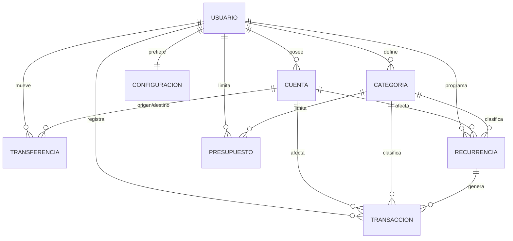

# 📊 FinTrack · Gestor de Finanzas Personales

Aplicación web **local-first** para registrar ingresos y gastos, controlar cuentas bancarias y efectivo, y consultar reportes. Funciona sin internet ni servidores: todos los datos viven en el navegador del usuario.

> **Este README es el documento técnico oficial del proyecto.**
> Todo cambio relevante (código, estructura, decisiones o pendientes) debe registrarse en la sección [Bitácora de cambios](#-bitácora-de-cambios).

---

## 📌 Estado del proyecto

| Área | Estado | Detalle |
| --- | --- | --- |
| Dominio (`src/models`) | ✅ Listo | Usuario, Cuenta, Categoría, Transacción, Transferencia, Recurrencia y Presupuesto |
| Persistencia local | ✅ Listo | Dexie sobre IndexedDB (esquema v3) |
| Autenticación local | ✅ Listo | Registro abierto, login, código de recuperación |
| Aislamiento por usuario | ✅ Listo | Todas las entidades llevan `usuarioId` y se filtran por sesión |
| Contrato de datos v3 | ✅ Listo | `FinanzasService` + `LocalFinanzasService` |
| Movimientos recurrentes | ✅ Listo | Reglas diarias, semanales y mensuales; generación solo al llegar la fecha |
| Presupuestos y alertas | ✅ Listo | Límite mensual por categoría, consumo con subcategorías, avisos y concentración de gasto |
| Meta de ahorro | ✅ Listo | Meta mensual en la configuración con avance en el resumen |
| Reportes | ✅ Listo | Estado de resultados, gastos por categoría, PDF y CSV |
| Interfaz de producto | ✅ Listo | `src/App.tsx`: resumen, movimientos, cuentas, categorías, reportes y perfil; diseño propio y responsive |
| Demo funcional | ✅ Referencia | `demo.html`: misma funcionalidad con React Bootstrap, útil para comparar el diseño |
| Tablas ordenables | ✅ Listo | Ciclo mayor a menor → menor a mayor → orden original en la app y en la demo |
| Modo offline (PWA) | ✅ Listo | Manifiesto, service worker y precache; instalable y 100 % offline |
| Despliegue público | ⏳ Pendiente | Guía paso a paso para Vercel incluida en este README |
| Sincronización remota | ⏳ Futuro | En el roadmap (Supabase + RLS); no implementada |

### Alcance actual

1. Modelo de dominio completo con validaciones y serialización.
2. Persistencia real en IndexedDB mediante Dexie, con migraciones sin pérdida de datos (v1 → v2 → v3).
3. Servicio único de datos con sesión, aislamiento por usuario y reportes.
4. Seguridad local: hash PBKDF2, sal por credencial y código de recuperación rotativo.
5. Exportación de respaldos JSON (v3), CSV y reportes PDF.
6. Movimientos recurrentes diarios, semanales y mensuales sin proyecciones futuras.
7. Presupuestos mensuales por categoría con consumo acumulado y alertas de concentración.
8. Meta de ahorro mensual y progreso en tiempo real.
9. Interfaz de producto en `src/App.tsx` y `src/paginas`: diseño propio en `src/index.css`, responsive y con navegación por estado.
10. Tablas ordenables por clic en el encabezado (y selector de orden en móvil).
11. Demo de referencia en `src/dev` + `demo.html`, construida solo con React Bootstrap.
12. PWA instalable con manifiesto, service worker y precache de todos los assets.

**Dos entradas, un solo servicio:** `index.html` monta la aplicación real (`src/main.tsx` → `App.tsx`); `demo.html` monta la demo (`src/dev/main-demo.tsx`). Ambas consumen `finanzasService`, pero **solo la app real entra al build de producción**. La demo se conserva como referencia visual y funcional.

---

## 🧰 Tecnologías

| Capa | Tecnología |
| --- | --- |
| Frontend | React 19 + TypeScript 6 |
| Empaquetador | Vite 8 |
| UI | Bootstrap 5 + React Bootstrap + CSS propio (`src/index.css`) |
| Iconografía | Bootstrap Icons |
| Tipografía | IBM Plex Sans (`@fontsource`) |
| Persistencia | Dexie 4 + IndexedDB (esquema v3) |
| Gráficos | Chart.js 4 + react-chartjs-2 |
| Reportes | jsPDF + jspdf-autotable |
| PWA | `vite-plugin-pwa` 2 + Workbox 7 |
| Pruebas de humo | Node + `fake-indexeddb` + `vite.ssrLoadModule` |
| Calidad | ESLint 10 + `tsc` |

---

## 🚀 Puesta en marcha

Requisitos: Node.js **22 LTS** o superior (Vite 8 exige ≥ 20.19 o ≥ 22.12) y npm.

```bash
npm ci          # instalación reproducible desde package-lock.json
npm run dev
```

| Comando | Descripción |
| --- | --- |
| `npm run dev` | Servidor de desarrollo en `http://localhost:5173` |
| `npm run build` | Verificación de tipos + build de producción |
| `npm run lint` | Análisis estático con ESLint |
| `npm test` | Pruebas de humo del servicio con `fake-indexeddb` |
| `npm run preview` | Sirve el build de producción (necesario para probar la PWA) |
| `node scripts/generar-iconos.mjs` | Regenera `public/favicon.svg` y los PNG de la PWA desde el logotipo en pixel art |

**Aplicación:** `http://localhost:5173/` (entrada real, `index.html`)
**Demo de referencia:** `http://localhost:5173/demo.html`

Solo la aplicación real forma parte del build de producción: `vite build` incluye únicamente `index.html`. La demo se conserva como referencia visual y funcional, y no se despliega.

---

## 📁 Estructura del proyecto

```
app-contabilidad/
├── demo.html                       # Entrada de la demo (solo desarrollo)
├── index.html                      # Entrada de la aplicación real
├── vite.config.ts                  # React + VitePWA (manifiesto y service worker)
├── public/
│   ├── favicon.svg                 # Favicon generado: un <rect> por píxel
│   ├── icons.svg                   # Iconos auxiliares
│   ├── pwa-192x192.png             # Icono PWA 192 x 192 (logotipo 12x)
│   └── pwa-512x512.png             # Icono PWA 512 x 512 (logotipo 32x)
├── scripts/
│   ├── generar-iconos.mjs          # Lee el logotipo 16 x 16 y genera favicon + PNG
│   └── smoke.mjs                   # Pruebas de humo del servicio (Node)
├── src/
│   ├── assets/
│   │   └── Logotipo.png            # Logotipo 16 x 16 (fuente de los iconos)
│   ├── componentes/                # UI compartida de la aplicación
│   │   ├── Avance.tsx              # Progreso de presupuestos y meta de ahorro
│   │   ├── Avisos.tsx              # Toasts de la aplicación
│   │   ├── ayudas.ts               # Utilidades de presentación
│   │   ├── BarraLateral.tsx        # Navegación lateral y menú inferior móvil
│   │   ├── Confirmar.tsx           # Diálogo de confirmación
│   │   ├── ejemplos.ts             # Carga de 8 movimientos de prueba
│   │   ├── Emoji.tsx               # Emoji o icono de categoría
│   │   ├── Encabezado.tsx          # Cabecera de sección
│   │   ├── Graficos.tsx            # Gráfico de flujo y de categorías
│   │   ├── Marca.tsx               # Logotipo + nombre
│   │   ├── orden.ts                # Comparadores y ciclo de orden
│   │   ├── paginas.ts              # Páginas navegables e iconos
│   │   ├── SelectorOrden.tsx       # Orden por lista en móvil
│   │   ├── ThOrdenable.tsx         # Encabezado de tabla ordenable
│   │   ├── useAvisos.ts            # Hook de toasts
│   │   └── useOrden.ts             # Hook de orden de tablas
│   ├── config/
│   │   └── app.ts                  # Moneda, locale, versión de BD, sesión, hash
│   ├── db/
│   │   ├── baseDatos.ts            # Esquema Dexie v3 (incluye presupuestos)
│   │   └── semilla.ts              # 34 categorías base, cuenta y configuración
│   ├── dev/                        # Demo de referencia (no entra al build)
│   │   ├── componentes/
│   │   │   ├── Estado.tsx          # Cargando, AlertaErrorCarga, TarjetaKpi
│   │   │   ├── ErrorBoundary.tsx   # Límite de errores de render
│   │   │   ├── Graficos.tsx        # Gráfico de flujo y de categorías
│   │   │   ├── Notificaciones.tsx  # Provider y toasts de React Bootstrap
│   │   │   ├── notificacionesContexto.ts # Contexto y useNotificaciones()
│   │   │   ├── ordenTabla.ts       # Comparadores de la demo
│   │   │   ├── TablaRecurrencias.tsx # Reglas recurrentes: pausar y eliminar
│   │   │   ├── tablaOrdenable.css  # Único CSS propio de la demo
│   │   │   ├── ThOrdenable.tsx     # Encabezado ordenable de la demo
│   │   │   ├── useErroresFormulario.ts   # Errores inline por campo
│   │   │   └── useOrdenTabla.ts    # Hook de orden de la demo
│   │   ├── pantallas/
│   │   │   ├── Acceso.tsx          # Login, registro, recuperación, código
│   │   │   ├── Dashboard.tsx       # KPIs, gráficos, últimos movimientos
│   │   │   ├── Movimientos.tsx     # Alta (con repetición), filtros y eliminación
│   │   │   ├── Cuentas.tsx         # Saldos, cuentas y transferencias
│   │   │   ├── Categorias.tsx      # Árbol ingreso/gasto, presupuestos y alta
│   │   │   ├── Reportes.tsx        # Periodo, estado de resultados, PDF y CSV
│   │   │   └── MiCuenta.tsx        # Perfil, contraseña, respaldo y borrado
│   │   ├── DemoDatos.tsx           # Shell: sesión, navbar y navegación
│   │   ├── main-demo.tsx           # Montaje de la demo
│   │   └── secciones.ts            # Secciones navegables
│   ├── models/
│   │   ├── Usuario.ts              # Usuario sin credenciales
│   │   ├── Cuenta.ts               # Efectivo, banco, ahorro, tarjeta
│   │   ├── Categoria.ts            # Categorías jerárquicas
│   │   ├── Transaccion.ts          # Ingreso o gasto
│   │   ├── Transferencia.ts        # Movimiento entre cuentas
│   │   ├── Recurrencia.ts          # Regla de gasto/ingreso repetitivo
│   │   ├── Presupuesto.ts          # Límite mensual por categoría
│   │   ├── errores.ts              # ErrorValidacion
│   │   ├── tipos.ts                # Constantes, tipos y DTOs
│   │   └── index.ts                # Barrel del dominio
│   ├── paginas/                    # Pantallas de la aplicación
│   │   ├── Acceso.tsx              # Login, registro y recuperación
│   │   ├── Resumen.tsx             # KPIs, alertas, meta de ahorro y cuentas
│   │   ├── Movimientos.tsx         # Alta (con repetición), filtros y edición
│   │   ├── Cuentas.tsx             # Saldos, cuentas y transferencias
│   │   ├── Categorias.tsx          # Árbol, presupuestos y consumo
│   │   ├── Reportes.tsx            # Periodo, estado de resultados, PDF y CSV
│   │   └── MiCuenta.tsx            # Perfil, contraseña, meta, respaldo y borrado
│   ├── services/
│   │   ├── FinanzasService.ts      # Contrato único (interfaz)
│   │   ├── LocalFinanzasService.ts # Implementación IndexedDB
│   │   └── index.ts                # Singleton `finanzasService`
│   ├── utils/
│   │   ├── criptografia.ts         # PBKDF2, sales y códigos
│   │   ├── descargas.ts            # Descargar y leer archivos
│   │   ├── errores.ts              # Normalizador de errores de la UI
│   │   ├── formato.ts              # Moneda CRC, fechas y etiquetas
│   │   ├── numeros.ts              # Redondeo y sumas
│   │   ├── recurrencia.ts          # Cálculo de ocurrencias y fin de mes
│   │   └── reportesPdf.ts          # Reportes con jsPDF + AutoTable
│   ├── App.css                     # Vacío: el diseño vive en index.css
│   ├── App.tsx                     # Interfaz de producto
│   ├── index.css                   # Sistema de diseño: tokens, layout y responsive
│   └── main.tsx                    # Montaje real
└── README.md
```

### Arquitectura local-first

```
App real / Demo (React + Bootstrap + CSS propio)
        │  solo conocen la interfaz
        ▼
finanzasService  ◄── contrato único (src/services/index.ts)
        │
        ▼
LocalFinanzasService
        │  obtiene el usuario de la sesión
        ▼
Dexie  ──►  IndexedDB (fintrack)
```

Regla de oro: **la interfaz nunca importa `LocalFinanzasService`**. Siempre usa `finanzasService`.

No hay llamadas de red en ningún punto de la aplicación: el flujo completo funciona con el servidor de desarrollo apagado una vez cargada la página.

---

## 🔐 Seguridad y aislamiento

| Aspecto | Implementación |
| --- | --- |
| Contraseñas | PBKDF2-SHA256, 210 000 iteraciones, sal aleatoria de 16 bytes por usuario |
| Comparación | Tiempo constante para evitar filtraciones por temporización |
| Código de recuperación | 12 caracteres (`XXXX-XXXX-XXXX`), alfabeto sin caracteres ambiguos |
| Almacenamiento del código | Hash PBKDF2 con **sal independiente**; nunca en claro |
| Rotación | El código se muestra una sola vez y se reemplaza al usarlo |
| Sesión | Solo el `usuarioId` en `sessionStorage` (`fintrack:sesion:v1`) |
| Validación de sesión | Cada operación verifica que el usuario exista en la base |
| Intentos fallidos | Espera exponencial tras 3 intentos (1 s, 2 s, 4 s… máximo 8 s) |
| Roles | No existen: registro abierto, sin administrador |
| Aislamiento | Todas las consultas filtran por `usuarioId`; las entidades ajenas se rechazan |

El servicio nunca devuelve hashes ni sales: el dominio expone `Usuario` sin credenciales. Las credenciales viven únicamente en la tabla interna `usuarios`.

> **Límite honesto:** al ser una aplicación local, la protección depende del navegador y del equipo. Los datos de IndexedDB no están cifrados en reposo; el hash protege las contraseñas, no el contenido financiero.

---

## 🧩 Modelo de datos



### `Usuario`

| Campo | Tipo | Descripción |
| --- | --- | --- |
| `id` | `string` | Identificador único (`usr-...`) |
| `nombre` | `string` | Nombre completo |
| `correo` | `string` | Correo normalizado a minúsculas; único |
| `creadoEn` | `string` | Fecha de creación ISO 8601 |
| `ultimoAcceso` | `string` | Último inicio de sesión ISO 8601 |

Miembro calculado: `iniciales` (`"Ana Rodríguez"` → `"AR"`).

### `Cuenta`

| Campo | Tipo | Descripción |
| --- | --- | --- |
| `id` | `string` | Identificador único (`cta-...`) |
| `usuarioId` | `string` | Dueño de la cuenta |
| `nombre` | `string` | Único por usuario (sin distinguir mayúsculas ni tildes) |
| `tipo` | `"efectivo"` \| `"banco"` \| `"ahorro"` \| `"tarjeta"` | Tipo fijo |
| `saldoInicial` | `number` | Punto de partida |
| `moneda` | `string` | `CRC` por defecto |
| `institucion` | `string` | Banco o entidad, opcional |
| `color` / `icono` | `string` | Presentación |
| `activa` | `boolean` | Las archivadas no admiten movimientos nuevos |
| `creadoEn` | `string` | ISO 8601 |

El **saldo no se almacena**: se calcula con saldo inicial + ingresos − gastos confirmados ± transferencias.

### `Categoria`

| Campo | Tipo | Descripción |
| --- | --- | --- |
| `id` | `string` | Identificador único (`cat-...`) |
| `usuarioId` | `string` | Dueño |
| `nombre` | `string` | Único entre hermanas del mismo tipo |
| `tipo` | `"ingreso"` \| `"gasto"` | Fijo desde su creación |
| `padreId` | `string \| null` | Categoría padre para jerarquía |
| `color` / `icono` | `string` | Presentación |

### `Transaccion`

| Campo | Tipo | Descripción |
| --- | --- | --- |
| `id` | `string` | Identificador único (`trx-...`) |
| `usuarioId` | `string` | Dueño |
| `cuentaId` | `string` | Cuenta afectada |
| `monto` | `number` | Siempre positivo, 2 decimales |
| `tipo` | `"ingreso"` \| `"gasto"` | Naturaleza del movimiento |
| `fecha` | `string` | Fecha real `AAAA-MM-DD` |
| `descripcion` | `string` | Obligatoria |
| `categoriaId` | `string` | Categoría del mismo tipo |
| `metodoPago` | `efectivo` \| `tarjeta` \| `transferencia` \| `sinpe` \| `otro` | Por defecto `otro` |
| `estado` | `"confirmado"` \| `"pendiente"` | Solo los confirmados afectan saldos y reportes |
| `etiquetas` | `string[]` | Sin duplicados |
| `creadoEn` | `string` | ISO 8601 |
| `recurrenciaId` | `string?` | Regla que generó el movimiento, si aplica |
| `recurrenciaFecha` | `string?` | Fecha de la ocurrencia dentro de la serie |

Miembros calculados: `esIngreso`, `montoFirmado`, `periodo` (`AAAA-MM`).

### `Transferencia`

| Campo | Tipo |
| --- | --- |
| `id` | `string` (`trf-...`) |
| `usuarioId` | `string` |
| `cuentaOrigenId` / `cuentaDestinoId` | `string` (deben ser distintas) |
| `monto` | `number` (> 0) |
| `fecha` | `AAAA-MM-DD` |
| `descripcion` | `string` (opcional) |
| `creadoEn` | ISO 8601 |

Las transferencias se guardan **aparte** de las transacciones: mueven saldos, pero no son ingreso ni gasto en los reportes.

### `Recurrencia`

| Campo | Tipo | Descripción |
| --- | --- | --- |
| `id` | `string` | Identificador único (`rec-...`) |
| `usuarioId` | `string` | Dueño de la regla |
| `cuentaId` / `categoriaId` | `string` | Referencias validadas contra el usuario y el tipo |
| `monto` | `number` | Siempre positivo, 2 decimales |
| `tipo` | `"ingreso"` \| `"gasto"` | Naturaleza del movimiento |
| `descripcion` | `string` | Obligatoria |
| `metodoPago` | `MetodoPago` | Se copia en cada ocurrencia |
| `etiquetas` | `string[]` | Se copian en cada ocurrencia |
| `frecuencia` | `"diaria"` \| `"semanal"` \| `"mensual"` | Cadencia de la serie |
| `fechaInicio` | `string` | Primera fecha de la serie (`AAAA-MM-DD`) |
| `fechaFin` | `string \| null` | Fin opcional de la serie |
| `diaAncla` | `number` | Día original del mes (1–31) para frecuencias mensuales |
| `proximaFecha` | `string` | Siguiente ocurrencia pendiente de generar |
| `activa` | `boolean` | Pausada o activa |
| `creadoEn` | `string` | ISO 8601 |

La regla **no crea movimientos virtuales ni proyecciones**: cuando `proximaFecha <= hoy`, el servicio inserta una transacción real, avanza `proximaFecha` y repite hasta agotar las ocurrencias vencidas. Las fechas futuras nunca se registran, por lo que los saldos no se alteran por adelantado.

### `ConfiguracionUsuario`

| Campo | Tipo | Descripción |
| --- | --- | --- |
| `usuarioId` | `string` | Dueño de la configuración |
| `moneda` | `string` | `CRC` por defecto |
| `locale` | `string` | `es-CR` |
| `tema` | `"claro"` \| `"oscuro"` | Preferencia visual |
| `metaAhorroMensual` | `number?` | Meta de ahorro del mes; `0` o ausente equivale a «sin meta» |

### `Presupuesto`

| Campo | Tipo | Descripción |
| --- | --- | --- |
| `id` | `string` | Identificador único (`pre-...`) |
| `usuarioId` | `string` | Dueño del límite |
| `categoriaId` | `string` | Categoría de gasto a limitar |
| `montoLimite` | `number` | Límite mensual positivo, 2 decimales |
| `periodo` | `string \| null` | Mes concreto `AAAA-MM` o `null` para repetirlo cada mes |
| `alertaPorcentaje` | `number` | Consumo que dispara la advertencia (1–100, por defecto 80) |
| `activo` | `boolean` | Un presupuesto inactivo no se evalúa |
| `creadoEn` | `string` | ISO 8601 |

Miembro calculado: `recurrente` (`periodo === null`) y método `aplicaA(periodo)`.

El presupuesto **no almacena el gasto**: al consultar un periodo, el servicio suma las transacciones confirmadas de la categoría **y de sus subcategorías**. Así el consumo nunca queda desincronizado del historial. Los tipos calculados `EstadoPresupuesto` y `AlertaConcentracionGasto` viven en `src/models/tipos.ts`.

### Enumeraciones (sin `enum`)

El proyecto compila con `erasableSyntaxOnly`, por lo que no se usan `enum`. Se emplean objetos `as const` que funcionan como valor y como tipo:

```ts
import { TipoCuenta, TipoTransaccion, TIPOS_CUENTA } from '../models';

TipoTransaccion.Ingreso; // 'ingreso'
TipoCuenta.Banco;        // 'banco'
```

---

## ✅ Reglas de negocio

1. El monto debe ser un número finito **mayor que cero**; el signo lo define el tipo.
2. Los montos se redondean a **2 decimales** al guardarse.
3. La fecha debe existir en el calendario y usar `AAAA-MM-DD`.
4. La descripción de una transacción es obligatoria.
5. Toda transacción apunta a una cuenta activa y a una categoría **del mismo usuario**.
6. El tipo de la categoría debe coincidir con el tipo de la transacción.
7. El nombre de una cuenta es único por usuario; el de una categoría, único entre hermanas del mismo tipo (sin mayúsculas ni tildes).
8. El tipo de una categoría no se puede cambiar; una subcategoría hereda el tipo de su padre.
9. Una cuenta archivada conserva historial pero no admite movimientos nuevos.
10. Los saldos y reportes solo consideran transacciones **confirmadas**.
11. Las transferencias requieren cuentas distintas y no alteran ingresos ni gastos.
12. Al registrarse se crean 34 categorías base, una cuenta de efectivo con saldo 0 y la configuración CRC/es-CR.
13. Los errores de negocio se lanzan como `ErrorValidacion` con un `campo` opcional.
14. El servicio devuelve copias: mutarlas no altera la base.
15. Una regla recurrente genera transacciones **solo cuando su fecha ya llegó** (`fecha <= hoy`); nunca se registran movimientos futuros ni proyecciones.
16. Al crear una regla se recuperan todas las ocurrencias vencidas desde `fechaInicio`; si la fecha es futura, no se crea ningún movimiento todavía.
17. `proximaFecha` y las inserciones se actualizan en la misma transacción Dexie, de modo que procesar dos veces es idempotente.
18. Las ocurrencias se guardan **confirmadas** y quedan vinculadas con `recurrenciaId` y `recurrenciaFecha`.
19. En frecuencias mensuales se usa `diaAncla` recortado al último día del mes: 31 de enero → 28/29 de febrero → 31 de marzo, sin desplazamiento permanente.
20. Al archivar una cuenta se pausan sus reglas; al eliminarlas o pausarlas, las transacciones ya generadas se conservan como historial.
21. Un presupuesto exige un límite finito **mayor que cero** (2 decimales) y una categoría de **gasto** del mismo usuario. No se admite más de un presupuesto activo por categoría.
22. `periodo` debe ser `AAAA-MM` o `null`; `null` significa que el límite se repite todos los meses. `alertaPorcentaje` va de 1 a 100 (por defecto 80).
23. Solo se evalúan presupuestos **activos** y aplicables al periodo consultado.
24. El consumo suma los **gastos confirmados** de la categoría y de todas sus subcategorías; un límite en Alimentación acumula Supermercado, Cafetería, etc.
25. Estado del presupuesto: **Normal** por debajo del umbral de alerta, **Advertencia** al alcanzarlo y **Excedido** al llegar o superar el 100 %.
26. La alerta de concentración marca las categorías cuyo gasto alcanza el **30 %** del gasto total del periodo (umbral configurable) y las ordena de mayor a menor porcentaje.
27. La meta de ahorro mensual se guarda en `metaAhorroMensual`; `0` o ausente equivale a «sin meta». El avance es `max(0, balance del mes) / meta`.
28. Al importar un respaldo se reemplazan los datos del usuario y se regeneran los ids; se aceptan versiones **1, 2 y 3**, y se rechazan versiones futuras.

---

## 🔌 Contrato del servicio (`FinanzasService`)

```ts
import { finanzasService } from './services';
```

La interfaz **no recibe `usuarioId`**: el servicio lo toma de la sesión activa.

### Sesión y cuenta

| Método | Devuelve | Notas |
| --- | --- | --- |
| `registrar(datos)` | `ResultadoRegistro` | Devuelve el código de recuperación una sola vez e inicia sesión |
| `iniciarSesion(correo, contrasena)` | `Usuario` | Normaliza el correo; aplica espera tras fallos |
| `cerrarSesion()` | `void` | Limpia `sessionStorage` |
| `usuarioActual()` | `Usuario \| null` | Valida la sesión contra la base |
| `cambiarContrasena(actual, nueva)` | `void` | Exige la contraseña actual |
| `recuperarContrasena(correo, codigo, nueva)` | `ResultadoRecuperacion` | Rota el código de recuperación |
| `eliminarCuenta(contrasena)` | `void` | Borra usuario y todos sus datos |
| `obtenerConfiguracion()` | `ConfiguracionUsuario` | Crea la configuración si falta |
| `actualizarConfiguracion(cambios)` | `ConfiguracionUsuario` | Cambios parciales; incluye `metaAhorroMensual` |

### Cuentas

| Método | Devuelve | Notas |
| --- | --- | --- |
| `listarCuentas()` | `Cuenta[]` | Orden alfabético |
| `crearCuenta(datos)` | `Cuenta` | Valida nombre único |
| `actualizarCuenta(id, cambios)` | `Cuenta` | Permite archivar/reactivar |
| `transferir(datos)` | `Transferencia` | Valida pertenencia y cuentas distintas |
| `obtenerSaldos()` | `SaldoCuenta[]` | Calculados con movimientos confirmados |

### Categorías

| Método | Devuelve | Notas |
| --- | --- | --- |
| `listarCategorias(tipo?)` | `Categoria[]` | Filtro opcional por tipo |
| `crearCategoria(datos)` | `Categoria` | Valida padre, tipo y nombre único entre hermanas |

### Transacciones

| Método | Devuelve | Notas |
| --- | --- | --- |
| `listarTransacciones(filtro?)` | `Transaccion[]` | Orden por defecto: fecha descendente |
| `obtenerTransaccion(id)` | `Transaccion \| null` | `null` si es de otro usuario |
| `crearTransaccion(datos)` | `Transaccion` | Valida cuenta, categoría y tipo |
| `actualizarTransaccion(id, cambios)` | `Transaccion` | Cambios parciales validados |
| `eliminarTransaccion(id)` | `void` | Falla si no existe o es ajena |

### Recurrencias

| Método | Devuelve | Notas |
| --- | --- | --- |
| `listarRecurrencias()` | `Recurrencia[]` | Activas primero, luego por próxima fecha |
| `crearRecurrencia(datos)` | `ResultadoCreacionRecurrencia` | Crea la regla y genera las ocurrencias vencidas |
| `actualizarRecurrencia(id, cambios)` | `Recurrencia` | Permite pausar/reanudar y fijar `fechaFin` |
| `eliminarRecurrencia(id)` | `void` | Conserva las transacciones ya generadas |
| `procesarRecurrencias()` | `number` | Genera lo vencido de todas las reglas activas; devuelve cuántas creó |

`NuevaRecurrencia` acepta `monto`, `tipo`, `fechaInicio`, `descripcion`, `categoriaId`, `cuentaId`, `frecuencia`, `fechaFin?`, `metodoPago?` y `etiquetas?`. El servicio valida las referencias con la misma lógica que una transacción.

```ts
const { recurrencia, generadas } = await finanzasService.crearRecurrencia({
  monto: 42000,
  tipo: 'gasto',
  fechaInicio: '2026-11-15',
  descripcion: 'Luz',
  categoriaId: 'cat-...',
  cuentaId: 'cta-...',
  frecuencia: 'mensual',
  fechaFin: null,
});

// Si hoy es 2026-11-15 y la regla empieza hoy, generadas === 1.
// Si empieza el 2026-12-01, generadas === 0 y proximaFecha === '2026-12-01'.
```

### Presupuestos

| Método | Devuelve | Notas |
| --- | --- | --- |
| `listarPresupuestos()` | `Presupuesto[]` | Incluye activos e inactivos |
| `crearPresupuesto(datos)` | `Presupuesto` | Valida categoría de gasto y límite |
| `actualizarPresupuesto(id, cambios)` | `Presupuesto` | Límite, periodo, alerta o estado |
| `eliminarPresupuesto(id)` | `void` | Borra el límite; conserva el historial |
| `obtenerEstadoPresupuestos(periodo?)` | `EstadoPresupuesto[]` | Consumo del mes (por defecto, el actual), incluye subcategorías |
| `obtenerAlertasConcentracion(periodo?, umbral?)` | `AlertaConcentracionGasto[]` | Categorías que superan el umbral (30 % por defecto) |

```ts
const estados = await finanzasService.obtenerEstadoPresupuestos('2026-11');

// Cada fila trae límite, gastado, disponible, porcentaje y estadoAlerta:
// 'normal' | 'advertencia' | 'excedido'.
```

### Reportes y datos

| Método | Devuelve | Notas |
| --- | --- | --- |
| `obtenerResumen(filtro?)` | `ResumenFinanciero` | Totales, categorías, meses y rango |
| `obtenerEstadoResultados(desde, hasta)` | `EstadoResultados` | Filas por categoría |
| `obtenerFlujoCaja(desde, hasta)` | `ResumenMensual[]` | Ingresos, gastos y balance por mes |
| `exportarRespaldo()` | `RespaldoFinanzas` | JSON completo del usuario |
| `importarRespaldo(respaldo)` | `void` | Reemplaza datos; **regenera ids y remapea referencias** |
| `exportarTransaccionesCsv(filtro?)` | `string` | Cabecera en español, separador coma |
| `resetearDatos()` | `void` | Borra movimientos, reglas, presupuestos y configuración, y restaura categorías y cuenta base |

### Filtros disponibles

```ts
interface FiltroTransacciones {
  desde?: string;              // AAAA-MM-DD, inclusive
  hasta?: string;              // AAAA-MM-DD, inclusive
  tipo?: TipoTransaccion;
  categoriaId?: string;
  cuentaId?: string;
  metodoPago?: MetodoPago;
  estado?: EstadoTransaccion;
  texto?: string;              // descripción, categoría, cuenta y etiquetas
  orden?: 'fecha-desc' | 'fecha-asc' | 'monto-desc' | 'monto-asc';
}
```

`ResumenFinanciero` expone `totalIngresos`, `totalGastos`, `balance`, cantidades, promedios, `porCategoria` (con porcentaje por tipo), `porMes` y el rango real cubierto. `porCategoria` se ordena de mayor a menor monto; `porMes`, del mes más antiguo al más reciente.

---

## 🗄️ Persistencia (IndexedDB con Dexie)

Base: **`fintrack`**, versión de esquema **3** (`src/db/baseDatos.ts`). Al cambiar tablas o índices hay que incrementar `versionBaseDatos` en `src/config/app.ts`. Las migraciones son incrementales y sin pérdida de datos: v2 añade reglas recurrentes y v3 agrega los presupuestos.

| Tabla | Clave primaria | Índices |
| --- | --- | --- |
| `usuarios` | `id` | `&correo` (único) |
| `cuentas` | `id` | `usuarioId`, `[usuarioId+tipo]` |
| `categorias` | `id` | `usuarioId`, `padreId`, `[usuarioId+tipo]` |
| `transacciones` | `id` | `usuarioId`, `cuentaId`, `categoriaId`, `fecha`, `recurrenciaId`, `[usuarioId+fecha]`, `[usuarioId+cuentaId]`, `[usuarioId+categoriaId]`, `[usuarioId+recurrenciaId]` |
| `transferencias` | `id` | `usuarioId`, `cuentaOrigenId`, `cuentaDestinoId`, `[usuarioId+fecha]` |
| `recurrencias` | `id` | `usuarioId`, `[usuarioId+activa]` |
| `presupuestos` | `id` | `usuarioId`, `categoriaId`, `[usuarioId+categoriaId]`, `[usuarioId+activo]` |
| `configuracion` | `usuarioId` | — |

La tabla `usuarios` guarda además `hashContrasena`, `sal`, `hashRecuperacion` y `salRecuperacion`; esos campos nunca salen del servicio.

### Semilla por usuario

- **34 categorías** jerárquicas pensadas para Costa Rica: salario, outsourcing (SINPE/efectivo), inversiones, servicios del hogar, suscripciones, alimentación (supermercado, minisúper, cafetería, restaurante, express), transporte (Didi/Uber, gasolina, bus/tren, mantenimiento), salud, educación, ocio, compras, mascotas y otros.
- Cuenta **Efectivo** con saldo 0.
- Configuración **CRC / es-CR / tema claro**.

### Respaldos

- Se exportan como JSON con `version`, `exportadoEn`, usuario y todas las colecciones, incluidas reglas y presupuestos.
- La versión actual es **3** (sigue `versionBaseDatos`). La importación acepta respaldos **v1**, **v2** y **v3**; se rechazan versiones futuras o archivos incompletos.
- Al importar se valida la versión y la integridad de las referencias, incluidas reglas y presupuestos.
- Los ids se **regeneran** y las relaciones se remapean (también `recurrenciaId` en cada movimiento) para evitar colisiones cuando varios usuarios comparten la misma base local.

---

## 🖥️ Interfaz de producto

`index.html` monta `src/main.tsx` → `src/App.tsx`. La navegación es por estado (no hay router instalado) y la sesión se retoma al abrir la pestaña. Antes de mostrar el resumen, la app procesa las reglas recurrentes vencidas para que los saldos ya las incluyan.

| Pantalla | Contenido |
| --- | --- |
| **Acceso** | Login, registro abierto, recuperación con código y pantalla de código único |
| **Resumen** | KPIs del mes, patrimonio, balance en formato de libro contable, alertas de concentración, avance de presupuestos, meta de ahorro, cuentas y últimos movimientos |
| **Movimientos** | Alta con tipo/monto/fecha/categoría/cuenta/método/estado/etiquetas y casilla **Repetir**; edición y eliminación, filtros, botón de 8 ejemplos y administración de reglas |
| **Cuentas** | Saldos calculados, alta y archivado de cuentas, transferencias entre cuentas |
| **Categorías** | Árbol ingreso/gasto con uso real, filtros, alta de raíces o subcategorías y presupuestos (fijar, editar, quitar) |
| **Reportes** | Rango de fechas con atajos, estado de resultados, gráficos, PDF y CSV |
| **Mi cuenta** | Perfil, cambio de contraseña, meta de ahorro mensual, respaldo exportar/importar, reset y eliminación |

El diseño vive en `src/index.css`: variables de color (paleta verde «pino»), tipografía IBM Plex Sans, iconografía Bootstrap Icons, tablas convertidas en listas en móvil, barra inferior de navegación, estilos de impresión y soporte de `prefers-reduced-motion`. `src/App.css` está vacío.

### Tablas ordenables

- **Movimientos**, **Cuentas**, **Categorías** y **Reportes** ordenan al pulsar el título de una columna. En pantallas táctiles/estrechas la tabla se muestra como lista y el orden se elige con el selector **Ordenar** (`SelectorOrden`).
- Cada columna sigue el ciclo del explorador de archivos: **mayor a menor → menor a mayor → orden original**. El tercer clic devuelve el orden que entrega el servicio (por ejemplo, movimientos de más reciente a más antiguo).
- Los montos se comparan por **valor absoluto**; texto y fechas usan las reglas del español (`Intl.Collator` con acentos y números) y las fechas ISO se comparan cronológicamente.
- Los valores vacíos (sin presupuesto, sin próxima fecha) quedan siempre al final, en ambas direcciones, y los empates conservan el orden de llegada.
- En Categorías se ordenan las raíces y, dentro de cada raíz, sus subcategorías: la jerarquía no se rompe. En Reportes solo se ordenan las filas de cada grupo; los totales quedan fijos.
- El orden vive en memoria: al cambiar de pantalla se reinicia. Los encabezados exponen `aria-sort` y una descripción para lectores de pantalla.
- La lógica está en `src/componentes/orden.ts` + `useOrden.ts` + `ThOrdenable.tsx`. La demo conserva su propia copia en `src/dev/componentes/`.

### Cómo funcionan los movimientos recurrentes

- En el formulario de movimientos, la casilla **“Repetir este movimiento”** convierte el alta en una regla. Se elige frecuencia (cada día, cada semana o cada mes) y, opcionalmente, una fecha final.
- Si la fecha de inicio es **hoy o anterior**, se registran de inmediato las ocurrencias vencidas (cada una con su fecha real). Si es **futura**, no se crea nada todavía: la tarjeta de reglas muestra la próxima fecha.
- Al abrir la aplicación se procesan las reglas activas antes de mostrar el resumen, para que los saldos ya incluyan lo vencido. Si estuvo cerrada varios días, recupera las ocurrencias atrasadas sin duplicarlas.
- Las transacciones generadas se marcan con 🔁 y se guardan confirmadas.
- **Pausar** detiene la generación; **Reanudar** recupera lo vencido durante la pausa. **Eliminar** borra la regla pero conserva los movimientos ya generados.
- En mensuales, el día se recorta al último del mes sin perder el original: una regla del día 31 genera el 28 de febrero de 2026 y vuelve al 31 en marzo.
- Si se archiva la cuenta asociada, sus reglas se pausan automáticamente.

### Reportes PDF

- **Estado de resultados:** ingresos, gastos y utilidad del periodo.
- **Gastos por categoría:** total, movimientos y porcentaje del gasto.
- Se generan con texto y tablas nativas de jsPDF (no capturas), con encabezado, pie y numeración.
- Los montos se escriben como `CRC 1 234,56` porque la fuente estándar de jsPDF no incluye el símbolo `₡`.

---

## 🧪 Demo de referencia (`/demo.html`)

Versión de la interfaz construida **solo con React Bootstrap** (sin el CSS de producto), útil para comparar el diseño y validar el servicio de forma aislada. Usa exactamente el mismo `finanzasService`.

| Pantalla | Contenido |
| --- | --- |
| **Acceso** | Login, registro abierto, recuperación con código y pantalla de código único |
| **Dashboard** | KPIs del mes, patrimonio, flujo mensual, gastos por categoría y últimos movimientos |
| **Movimientos** | Alta con tipo/monto/fecha/categoría/cuenta/método/estado/etiquetas y casilla **Repetir** (diaria, semanal o mensual, con fin opcional); administración de reglas (pausar, reanudar, eliminar), filtros y eliminación; botón de 8 ejemplos; encabezados ordenables |
| **Cuentas** | Saldos calculados, alta y archivado de cuentas, transferencias entre cuentas; encabezados ordenables |
| **Categorías** | Árbol ingreso/gasto con uso real y alta de raíces o subcategorías; encabezados ordenables (raíces y hermanos) |
| **Reportes** | Rango de fechas con atajos, estado de resultados, gráficos, PDF y CSV; encabezados ordenables dentro de cada grupo |
| **Mi cuenta** | Perfil, cambio de contraseña, respaldo exportar/importar, reset y eliminación |

La navegación es por estado (no hay router instalado). La demo usa React Bootstrap y un único CSS propio, `src/dev/componentes/tablaOrdenable.css`, que ajusta el botón del encabezado ordenable. Los resultados de las acciones se informan con toasts; los errores de campo se muestran inline y los fallos de carga con una alerta que permite reintentar.

---

## 📲 PWA e instalación offline

La aplicación se puede instalar en escritorio o móvil y funciona sin conexión después de la primera visita.

### Configuración

`vite.config.ts` integra `VitePWA` con:

- `registerType: 'autoUpdate'`: la versión nueva del service worker se activa sola y `cleanupOutdatedCaches` elimina las cachés anteriores.
- `injectRegister: 'auto'`: el registro del service worker se inyecta en el HTML generado, **sin tocar `src/main.tsx`**.
- `workbox.globPatterns: ['**/*.{js,css,html,ico,png,svg,woff2}']`: precachea todo el shell estático.
- `navigateFallback: '/index.html'`: cualquier ruta del SPA se resuelve desde la caché.

El manifiesto declara `name`, `short_name`, `description`, `start_url: "/"`, `display: "standalone"`, `background_color: "#ffffff"`, `theme_color: "#0d6efd"`, `lang: "es-CR"` e iconos de 192 y 512 px.

| Artefacto del build | Contenido |
| --- | --- |
| `dist/manifest.webmanifest` | Manifiesto de la aplicación |
| `dist/sw.js` | Service worker con el precache de los assets |
| `dist/registerSW.js` | Registro inyectado en `index.html` |
| `dist/workbox-*.js` | Runtime de Workbox |

Los iconos se generan localmente con `scripts/generar-iconos.mjs`, que lee el logotipo en pixel art de 16 x 16 RGBA (busca `assets/logotipo.png` y, si no existe, `src/assets/Logotipo.png`). El decodificador PNG usa únicamente `node:zlib`, sin dependencias externas, y produce:

- `public/favicon.svg`: un `<rect>` de 1 x 1 por cada píxel no transparente, con `shape-rendering="crispEdges"`.
- `public/pwa-192x192.png`: escalado Nearest Neighbor exacto de 12x.
- `public/pwa-512x512.png`: escalado Nearest Neighbor exacto de 32x.

Para cambiar el diseño basta con reemplazar el logotipo por otro PNG de 16 x 16 y volver a ejecutar el script.

### Instalación y prueba offline

1. `npm run build` y `npm run preview`.
2. Abrir `http://localhost:4173`.
3. Instalar desde el icono de la barra de direcciones (escritorio) o desde el menú del navegador → “Instalar aplicación” / “Añadir a pantalla de inicio” (móvil).
4. En DevTools → Application → Service Workers, activar **Offline** y recargar: la app abre y opera con IndexedDB.

> El service worker solo se registra en `localhost` o HTTPS. La primera visita necesita red para descargar la app; a partir de ahí todo queda cacheado. `demo.html`, `src/dev` y el código de desarrollo no entran al build ni al precache.

---

## ☁️ Despliegue en Vercel

La app es **estática**: no necesita variables de entorno, backend ni base de datos remota. Cada usuario guarda sus datos en el IndexedDB de su navegador.

### Desde el panel de Vercel

1. Fusiona la rama de trabajo en `main` (Vercel publica producción desde `main`; las demás ramas generan *previews*).
2. Entra a [vercel.com](https://vercel.com) con GitHub → **Add New… → Project** → importa `Salware-20/FinTrack`.
3. Confirma la configuración detectada:

| Campo | Valor |
| --- | --- |
| Framework Preset | **Vite** |
| Root Directory | `./` |
| Build Command | `npm run build` |
| Output Directory | `dist` |
| Install Command | `npm install` (usa el lockfile) |
| Environment Variables | ninguna |

4. En **Settings → General → Node.js Version** elige **22.x** (Vite 8 exige ≥ 20.19 o ≥ 22.12).
5. **Deploy**. Al terminar, abre la URL `https://…vercel.app`.

### Desde la CLI

```powershell
npm install -g vercel
vercel login
vercel            # preview
vercel --prod     # producción
```

Añade `.vercel` al `.gitignore` si usas la CLI.

### Verificación posterior

- La app abre sin errores en la consola y el registro funciona.
- DevTools → Application → Service Workers: el SW queda activo con scope `/`.
- Application → Manifest: “FinTrack” con iconos de 192 y 512 px.
- Modo **Offline** en DevTools: la app sigue abriendo con el shell precacheado.

### Problemas típicos

| Síntoma | Causa | Solución |
| --- | --- | --- |
| Build falla con errores de `crypto` o sintaxis | Node viejo | Settings → Node.js Version → **22.x** → Redeploy |
| Se ve una versión anterior tras desplegar | Service worker con precache viejo | DevTools → Service Workers → **Unregister** + Clear site data, o abrir en incógnito |
| Aviso de `install-scripts` (`core-js`) | npm 11 pide aprobar scripts | Informativo; no bloquea el build ni afecta a la app |
| `npm audit` con moderadas | Dependencias de build (`glob`, `minimatch`) | No entran al bundle ni bloquean el despliegue |

---

## 👩‍💻 Guía rápida para el frontend

### 1. Arrancar la aplicación y entrar

```bash
npm run dev
# aplicación: http://localhost:5173/
# demo:       http://localhost:5173/demo.html
```

Registre un usuario; el código de recuperación se muestra una sola vez.

### 2. Leer datos

```tsx
import { useEffect, useState } from 'react';
import type { ResumenFinanciero } from './models';
import { finanzasService } from './services';

function Panel() {
  const [resumen, setResumen] = useState<ResumenFinanciero | null>(null);

  useEffect(() => {
    let activo = true;
    finanzasService.obtenerResumen().then((datos) => {
      if (activo) setResumen(datos);
    });
    return () => {
      activo = false;
    };
  }, []);

  if (!resumen) return <p>Cargando…</p>;
  return <p>Balance: {resumen.balance}</p>;
}
```

### 3. Registrar un gasto

```tsx
import { MetodoPago, TipoTransaccion } from './models';
import { finanzasService } from './services';

await finanzasService.crearTransaccion({
  monto: 25000,
  tipo: TipoTransaccion.Gasto,
  fecha: '2026-11-15',
  descripcion: 'Supermercado',
  categoriaId: 'cat-...',
  cuentaId: 'cta-...',
  metodoPago: MetodoPago.Tarjeta,
});
```

### 4. Manejar errores

La demo aplica cuatro reglas de presentación:

| Situación | Presentación |
| --- | --- |
| Acción completada | Toast de éxito abajo a la derecha |
| Error de campo (`ErrorValidacion.campo`) | Mensaje inline bajo el campo (`isInvalid` + `Form.Control.Feedback`) |
| Error general o técnico | Toast de error con mensaje en español, sin detalles de Dexie/IndexedDB |
| Pantalla que no puede cargar | Alerta inline con botón **Reintentar** |

`normalizarError` convierte cualquier fallo en `{ mensaje, campo?, tipo }`. Los tipos son `validacion`, `sesion`, `almacenamiento` y `desconocido`.

```tsx
import { normalizarError } from './utils/errores';

try {
  await finanzasService.crearTransaccion(datos);
} catch (fallo) {
  const error = normalizarError(fallo);
  if (error.campo === 'monto') {
    setErrorMonto(error.mensaje); // inline
  } else {
    notificaciones.error(error.mensaje); // toast
  }
}
```

En el login no se marcan campos concretos: el toast usa el mismo mensaje para correo inexistente o contraseña incorrecta. En la app real las acciones destructivas usan el diálogo `Confirmar` y los avisos salen de `useAvisos`; la demo conserva `window.confirm` y `useNotificaciones`. `ErrorBoundary` evita que un fallo de render deje la sección en blanco.

### 5. Formatear valores

```ts
import { formatearMoneda, formatearFecha } from './utils/formato';

formatearMoneda(950000);        // "₡950 000,00"
formatearFecha('2026-11-15');   // "15 de noviembre de 2026"
```

Las pantallas de `src/paginas` son la referencia completa de consumo del servicio; la demo de `src/dev/pantallas` muestra el mismo contrato con otro diseño.

---

## 🧭 Convenciones de código

- **Dominio en español** (`Transaccion`, `categoriaId`); infraestructura en inglés (`services`, `config`).
- **Sin `enum`**: objetos `as const` + tipo unión (requisito de `erasableSyntaxOnly`).
- **Sin parámetros de propiedad** en constructores (`constructor(private x)`), por la misma razón.
- `import type` obligatorio para importaciones de solo tipo (`verbatimModuleSyntax`).
- `noUnusedLocals` y `noUnusedParameters` activos.
- Fechas de dominio como `AAAA-MM-DD`; marcas de tiempo en ISO 8601.
- Montos positivos en el dominio; el signo se deriva con `montoFirmado`.
- Entidades con `toJSON()` y `desdeJSON()`.
- Operaciones de datos siempre asíncronas.
- Efectos de React que cargan datos usan promesas con guardas (`activo`) para cumplir `react-hooks/set-state-in-effect`.
- Gráficos: contenedor con `ratio ratio-16x9` y `maintainAspectRatio: false`.
- Orden de tablas: comparadores puros en `orden.ts`, estado en `useOrden` y encabezado accesible en `ThOrdenable`.
- La app y la demo **no comparten CSS**: el producto usa `src/index.css`; la demo solo `tablaOrdenable.css` + Bootstrap.

### Reparto de archivos

| Zona | Responsable | Regla |
| --- | --- | --- |
| `src/models`, `src/services`, `src/db`, `src/utils`, `src/config` | Capa de datos | Cambios coordinados y registrados en la bitácora |
| `src/App.tsx`, `src/main.tsx`, `src/paginas`, `src/componentes`, `src/index.css` | Interfaz de producto | UI oficial; los cambios visuales se hacen aquí |
| `src/dev`, `demo.html` | Demostración | Referencia visual; no se incluye en el build |

---

## 🧪 Verificación

```bash
npm run build   # tsc -b + vite build
npm run lint    # ESLint
npm test        # 103 comprobaciones de comportamiento
```

La prueba de humo (`scripts/smoke.mjs`) usa `fake-indexeddb` y `vite.ssrLoadModule` y cubre:

- registro, normalización de correo y correo duplicado;
- 34 categorías base, cuenta inicial y saldo 0;
- CRUD de cuentas y transacciones, validación de tipo y monto;
- saldos con gastos, ingresos y transferencias;
- reportes, estado de resultados, flujo mensual y CSV;
- aislamiento entre dos usuarios (lectura y escritura);
- respaldo, importación con ids regenerados y reseteo;
- movimientos recurrentes: ocurrencias vencidas, idempotencia, reglas futuras sin movimientos, pausa/reanudación, fin de mes, respaldo/importación con remapeo y aislamiento entre usuarios;
- presupuestos: estados normal/advertencia/excedido, consumo con subcategorías, alertas de concentración y respaldo v3;
- normalización de errores de validación, sesión, cuota de almacenamiento y fallos técnicos;
- cambio de contraseña, recuperación con rotación de código y eliminación de cuenta;
- ordenamiento de tablas: ciclo descendente/ascendente/original, texto con acentos y números, fechas, montos, valores vacíos al final y empates estables.

El build de producción genera `dist/manifest.webmanifest`, `dist/sw.js` y los iconos de la PWA, y **no incluye** `demo.html` ni `src/dev`. Para verificarlo:

```powershell
npm run build
Select-String -Path dist/sw.js -Pattern 'demo\.html|src/dev'   # sin coincidencias
```

La instalación y el modo offline se comprueban con `npm run preview` y DevTools → Application → Manifest y Service Workers.

> `npm audit` reporta vulnerabilidades moderadas en dependencias **de build** (`glob` vía `workbox-build`, `minimatch` vía `typescript-eslint`). No se incluyen en el bundle ni se ejecutan en el navegador; no usar `npm audit fix --force` porque degradaría `vite-plugin-pwa` a una versión incompatible.

---

## 🗺️ Pendientes (roadmap)

- [x] Interfaz de producto responsive en `App.tsx` y `src/paginas`.
- [x] Manifiesto PWA y service worker para instalación offline.
- [x] Presupuestos por categoría y alertas de concentración.
- [x] Meta de ahorro mensual con progreso.
- [x] Tablas ordenables por encabezado y selector móvil.
- [x] Edición de movimientos desde la UI.
- [ ] Edición de monto, categoría, frecuencia y fecha final de reglas recurrentes desde la UI.
- [ ] Despliegue público en Vercel (guía lista en este README).
- [ ] Cifrado de la base local con frase de paso (opcional).
- [ ] Sincronización opcional con Supabase y RLS, si el cliente la pide más adelante.
- [ ] Exportación de reportes en otros formatos.

---

## 🗓️ Bitácora de cambios

| Fecha | Cambio | Archivos |
| --- | --- | --- |
| 2026-11-14 | Inicialización del repositorio con plantilla Vite + React + TypeScript y Bootstrap instalado. | `package.json`, `src/main.tsx` |
| 2026-11-14 | README inicial con la visión del gestor de finanzas personales. | `README.md` |
| 2026-11-14 | **Entrega 1 — capa de dominio y datos simulados.** Clases `Usuario`, `Categoria` y `Transaccion` con validaciones; tipos y DTOs; interfaz `FinanzasService`; `MockFinanzasService` con persistencia en `localStorage`, latencia simulada y copias defensivas; seed de 13 categorías y 39 transacciones relativas a la fecha actual; utilidades de formato para CRC y fechas; página demo `/demo.html`. | `src/models/*`, `src/services/*`, `src/data/seed.ts`, `src/utils/*`, `src/config/mock.ts`, `src/dev/*`, `demo.html` |
| 2026-11-14 | README convertido en documento técnico: arquitectura, modelo de datos, contrato del servicio, reglas de negocio, guía de consumo, persistencia, migración a Supabase, convenciones y bitácora. | `README.md` |
| 2026-11-14 | Variables de entorno documentadas y credenciales excluidas del repositorio. | `.env.example`, `.gitignore` |
| 2026-11-15 | **Entrega 2 — MVP local-first.** Se instalan Dexie, Chart.js, jsPDF, jspdf-autotable y fake-indexeddb. Se reemplazan el mock, el seed y la configuración simulada por una base IndexedDB real con sesión, aislamiento por usuario y credenciales PBKDF2. Se añaden cuentas, categorías jerárquicas, transferencias, respaldos y reportes. | `package.json`, `src/config/app.ts`, `src/db/*`, `src/models/*`, `src/services/*` |
| 2026-11-15 | Autenticación local: registro abierto sin roles, login, cambio de contraseña, recuperación con código de 12 caracteres mostrado una vez y rotado al usarlo, y eliminación de cuenta. | `src/utils/criptografia.ts`, `src/services/LocalFinanzasService.ts`, `src/models/Usuario.ts` |
| 2026-11-15 | Reportes y exportaciones: estado de resultados, gastos por categoría, PDF con jsPDF/AutoTable, CSV y respaldo JSON con remapeo de ids al importar. | `src/utils/reportesPdf.ts`, `src/utils/descargas.ts`, `src/services/LocalFinanzasService.ts` |
| 2026-11-15 | Demo visual completa solo en `src/dev`: acceso, dashboard, movimientos, cuentas, categorías, reportes y mi cuenta, con navegación por estado y React Bootstrap. No se tocaron `App.tsx`, `main.tsx` ni los CSS. | `src/dev/*`, `demo.html` |
| 2026-11-15 | Prueba de humo automatizada (`npm test`) con 44 verificaciones sobre `fake-indexeddb`; se corrige la importación de respaldos para regenerar identificadores y remapear referencias. | `scripts/smoke.mjs`, `package.json`, `src/services/LocalFinanzasService.ts` |
| 2026-11-15 | README reescrito como documento técnico del MVP local-first: arquitectura, seguridad, modelo, contrato v2, persistencia, demo y verificación. | `README.md` |
| 2026-11-15 | **Nivel B — manejo de errores en la demo.** Normalizador compartido (`normalizarError`), toasts de React Bootstrap, validación inline por campo, alertas con reintento para cargas fallidas y `ErrorBoundary`. El login usa un mensaje genérico para no revelar si el correo existe; las acciones destructivas conservan la confirmación. La prueba de humo sube de 44 a 48 comprobaciones. | `src/utils/errores.ts`, `src/dev/componentes/Notificaciones.tsx`, `notificacionesContexto.ts`, `useErroresFormulario.ts`, `ErrorBoundary.tsx`, `Estado.tsx`, `src/dev/pantallas/*`, `src/dev/DemoDatos.tsx`, `scripts/smoke.mjs`, `README.md` |
| 2026-11-15 | **Movimientos recurrentes.** Nueva entidad `Recurrencia` con frecuencias diaria, semanal y mensual; tabla Dexie v2, índice `recurrenciaId` y migración sin pérdida de datos. El servicio crea reglas, genera ocurrencias vencidas hasta hoy (nunca futuras), recupera atrasos al iniciar sesión, evita duplicados con avance atómico de `proximaFecha` y conserva el historial al pausar o eliminar. Fin de mes anclado al día original. Respaldos v2 con retrocompatibilidad v1. UI en Movimientos: casilla “Repetir”, fecha final opcional y tarjeta de reglas con pausar/reanudar/eliminar. La prueba de humo sube de 48 a 75 comprobaciones. | `src/models/Recurrencia.ts`, `tipos.ts`, `Transaccion.ts`, `index.ts`, `src/utils/recurrencia.ts`, `formato.ts`, `src/db/baseDatos.ts`, `src/config/app.ts`, `src/services/*`, `src/dev/pantallas/Movimientos.tsx`, `src/dev/componentes/TablaRecurrencias.tsx`, `src/dev/DemoDatos.tsx`, `scripts/smoke.mjs`, `README.md` |
| 2026-11-16 | **PWA offline e instalable.** Se instala `vite-plugin-pwa` 2 y se configura `VitePWA` con `registerType: 'autoUpdate'`, precache de JS/CSS/HTML/ICO/PNG/SVG/WOFF2, `cleanupOutdatedCaches` y `navigateFallback` al `index.html`. Manifiesto FinTrack en modo `standalone` con `theme_color: #0d6efd` e iconos de 192 y 512 px. El registro del service worker se inyecta automáticamente, sin tocar `main.tsx`. Se añaden los iconos PNG generados por `scripts/generar-iconos.mjs` (sin dependencias) y en `index.html` el `theme-color` y el `apple-touch-icon`. El build produce `manifest.webmanifest` y `sw.js` sin incluir `demo.html` ni `src/dev`; build, lint y 75 pruebas en verde. | `package.json`, `package-lock.json`, `vite.config.ts`, `index.html`, `public/pwa-192x192.png`, `public/pwa-512x512.png`, `scripts/generar-iconos.mjs`, `README.md` |
| 2026-11-16 | **Sistema híbrido de control de gastos y presupuestos.** Entidad Presupuesto con validaciones y serialización. Esquema Dexie v3 con tabla presupuestos e índices compuestos. CRUD de presupuestos con cálculo de consumo acumulado por jerarquía (subcategorías) y clasificación de estados (Normal, Advertencia, Excedido). Alerta automática por concentración de gasto (>= 30% del gasto total). Meta de ahorro mensual en configuración y progreso en tiempo real. Soporte completo en respaldos v3 con retrocompatibilidad v1/v2. En UI: Alertas de consumo y progreso en Dashboard, gestión de presupuestos en Categorías y meta de ahorro en Mi Cuenta. Pruebas de humo suben a 91 verificaciones. | src/models/*, src/db/*, src/services/*, src/dev/*, scripts/smoke.mjs, README.md |
| 2026-11-17 | **Iconos generados desde el logotipo en pixel art.** `scripts/generar-iconos.mjs` lee `src/assets/Logotipo.png` (16 x 16 RGBA) con un decodificador PNG propio basado en `node:zlib` (chunks IDAT, filtros None/Sub/Up/Average/Paeth, sin dependencias externas) y genera `public/favicon.svg` (un `<rect>` por píxel no transparente, `shape-rendering="crispEdges"`) y los PNG `pwa-192x192.png` y `pwa-512x512.png` con escalado Nearest Neighbor exacto de 12x y 32x. El build de la PWA precachea los tres archivos y el manifiesto los referencia. | `scripts/generar-iconos.mjs`, `public/favicon.svg`, `public/pwa-192x192.png`, `public/pwa-512x512.png`, `README.md` |
| 2026-11-17 | **Reparación de codificación (mojibake).** Diez archivos heredados del commit `1d71ae4` tenían texto UTF-8 re-interpretado como Windows-1252 (acentos y emojis convertidos en secuencias extrañas) y BOM añadidos por la misma corrupción. Se restauraron los caracteres originales tramo por tramo, conservando los fragmentos que ya estaban correctos, y se eliminaron los BOM y los caracteres de control `U+008D`/`U+008F`. Resultado: 0 marcas de mojibake y UTF-8 sin BOM en todo el proyecto; build, lint y 91 pruebas en verde. | `scripts/smoke.mjs`, `src/config/app.ts`, `src/db/baseDatos.ts`, `src/db/semilla.ts`, `src/dev/pantallas/*`, `src/models/tipos.ts`, `src/services/FinanzasService.ts`, `src/services/LocalFinanzasService.ts`, `README.md` |
| 2026-11-17 | **Tablas ordenables en la demo.** Módulo puro `ordenTabla.ts` (comparadores de texto con `Intl.Collator` en español, número, fecha y booleano), hook `useOrdenTabla` y encabezado accesible `ThOrdenable` con `aria-sort`. Cada columna cicla mayor a menor → menor a mayor → orden original; los montos se ordenan por valor absoluto y los vacíos quedan al final. Se aplica a Movimientos, Cuentas, reglas recurrentes, Categorías (raíces y hermanos, jerarquía intacta) y Reportes (solo filas internas de cada grupo); el Dashboard no cambia. El orden es en memoria y se reinicia al navegar. Sin dependencias nuevas y todo dentro de `src/dev`. La prueba de humo sube de 91 a 103 comprobaciones. | `src/dev/componentes/ordenTabla.ts`, `useOrdenTabla.ts`, `ThOrdenable.tsx`, `tablaOrdenable.css`, `TablaRecurrencias.tsx`, `src/dev/pantallas/{Movimientos,Cuentas,Categorias,Reportes}.tsx`, `scripts/smoke.mjs`, `README.md` |
| 2026-11-18 | **Interfaz de producto integrada** (commits `4cafca2`, `8056822`, `ed0a969`). La app real sale del placeholder: `App.tsx` orquesta sesión, navegación por estado y procesamiento de recurrencias; `src/paginas/*` implementa acceso, resumen, movimientos (alta, edición, filtros, repetición), cuentas, categorías, reportes y mi cuenta. Se añade un sistema de diseño propio en `src/index.css` (tokens de color, IBM Plex Sans, Bootstrap Icons, layout responsive con barra inferior móvil, estilos de impresión y `prefers-reduced-motion`). Se incorporan la gestión de presupuestos y la meta de ahorro, las tablas ordenables del producto (`orden.ts`, `useOrden`, `ThOrdenable`, `SelectorOrden` para móvil) y la edición de movimientos. La demo de `src/dev` se conserva íntegra como referencia y sigue fuera del build. Build, lint y 103 pruebas en verde. | `src/App.tsx`, `src/main.tsx`, `src/componentes/*`, `src/paginas/*`, `src/index.css`, `package.json`, `package-lock.json` |
| 2026-11-18 | **README actualizado al estado real del proyecto.** Se corrigen el estado y el alcance (interfaz de producto lista, esquema Dexie v3, presupuestos y meta de ahorro), se documenta la entidad `Presupuesto` con sus reglas de negocio y contrato, la tabla `presupuestos` y los respaldos v3 (compatibles v1/v2), el sistema de diseño y las tablas ordenables del producto, la diferencia entre app real y demo de referencia, el despliegue en Vercel y el estado real de la verificación (103 comprobaciones, auditoría de dependencias de build). | `README.md` |
