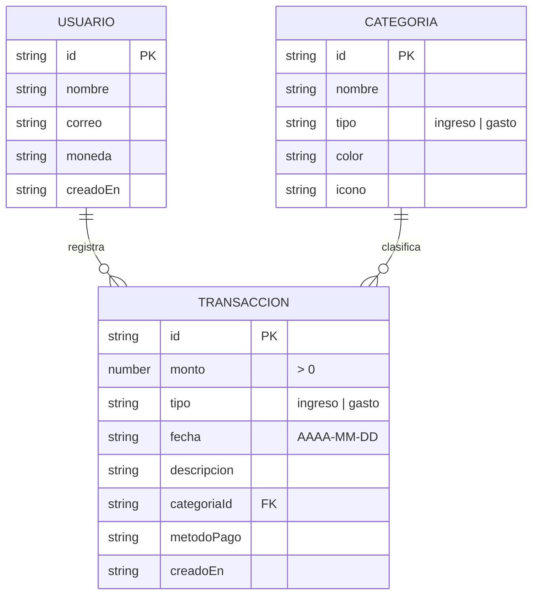

# 📊 FinTrack · Gestor de Finanzas Personales

Aplicación web para registrar ingresos y gastos, consultarlos por categoría o de forma general, y usarla tanto en el hogar como en equipos compartidos o sin conexión estable.

> **Este README es el documento técnico oficial del proyecto.**
> Todo cambio relevante (código, estructura, decisiones o pendientes) debe registrarse en la sección [Bitácora de cambios](#-bitácora-de-cambios).

---

## 📌 Estado del proyecto

| Área | Estado | Detalle |
| --- | --- | --- |
| Scaffold (Vite + React + TypeScript) | ✅ Listo | Interfaz de prueba funcionando con Bootstrap |
| Modelo de dominio | ✅ Listo | Clases `Usuario`, `Categoria`, `Transaccion` |
| Contrato de datos | ✅ Listo | Interfaz `FinanzasService` (asíncrona) |
| Capa de datos simulada (mock) | ✅ Listo | CRUD + resúmenes sobre `localStorage` |
| Página de demostración | ✅ Listo | `demo.html`, solo para desarrollo |
| Interfaz real de la aplicación | 🚧 En desarrollo | A cargo del trabajo de frontend |
| Supabase (base de datos real) | ⏳ Pendiente | Solo documentado; el mock lo reemplazará |
| Autenticación | ⏳ Pendiente | Hoy existe un usuario de demostración |
| Modo sin conexión (PWA) | ⏳ Pendiente | El mock ya persiste localmente |

### Alcance de la entrega actual

Esta entrega **no incluye interfaz definitiva**. Entrega la base para que el frontend se construya en paralelo:

1. Modelos de dominio con validaciones y serialización.
2. Un contrato único de acceso a datos (`FinanzasService`).
3. Una implementación mock funcional con datos de demostración realistas.
4. Utilidades de formato para colones y fechas.
5. Una página demo para comprobar que todo funciona.

No se modificaron `src/App.tsx` ni `src/main.tsx`: la aplicación real sigue intacta para el trabajo de frontend.

---

## 🧰 Tecnologías

| Capa | Tecnología |
| --- | --- |
| Frontend | React 19 + TypeScript 6 |
| Empaquetador | Vite 8 |
| UI | Bootstrap 5 + React Bootstrap |
| Persistencia actual | `localStorage` (mock) |
| Persistencia objetivo | Supabase (PostgreSQL) |
| Calidad | ESLint 10 + `tsc` |

---

## 🚀 Puesta en marcha

Requisitos: Node.js 20 o superior y npm.

```bash
npm install
npm run dev
```

| Comando | Descripción |
| --- | --- |
| `npm run dev` | Servidor de desarrollo en `http://localhost:5173` |
| `npm run build` | Verificación de tipos + build de producción |
| `npm run lint` | Análisis estático con ESLint |
| `npm run preview` | Sirve el build de producción |

**Página de demostración de datos:** `http://localhost:5173/demo.html`
(No forma parte del build de producción; es una herramienta de desarrollo.)

---

## 📁 Estructura del proyecto

```
app-contabilidad/
├── demo.html                  # Entrada de la página demo (solo desarrollo)
├── index.html                 # Entrada de la aplicación real
├── public/
├── src/
│   ├── config/
│   │   └── mock.ts            # Clave de storage, versión, latencia, moneda
│   ├── data/
│   │   └── seed.ts            # Usuario, categorías y transacciones de ejemplo
│   ├── dev/
│   │   ├── DemoDatos.tsx      # Página de verificación del mock
│   │   └── main-demo.tsx      # Montaje de la demo
│   ├── models/
│   │   ├── Categoria.ts       # Entidad categoría
│   │   ├── Transaccion.ts     # Entidad transacción + validaciones
│   │   ├── Usuario.ts         # Entidad usuario
│   │   ├── errores.ts         # ErrorValidacion
│   │   ├── tipos.ts           # Tipos, constantes y DTOs
│   │   └── index.ts           # Barrel del dominio
│   ├── services/
│   │   ├── FinanzasService.ts      # Contrato (interfaz)
│   │   ├── MockFinanzasService.ts  # Implementación con localStorage
│   │   └── index.ts                # Instancia `finanzasService`
│   ├── utils/
│   │   ├── formato.ts         # Moneda CRC, fechas, porcentajes
│   │   └── numeros.ts         # Redondeo y sumas de montos
│   ├── App.tsx                # Interfaz real (trabajo de frontend)
│   └── main.tsx               # Montaje de la aplicación real
├── .env.example               # Variables de entorno documentadas
└── README.md                  # Este documento
```

### Arquitectura de la capa de datos

```
Componentes React
      │  (solo conocen la interfaz)
      ▼
FinanzasService  ◄── contrato único
      │
      ├── MockFinanzasService  (HOY: localStorage + seed)
      └── SupabaseFinanzasService (FUTURO: PostgreSQL remoto)
```

Regla de oro: **el frontend nunca importa `MockFinanzasService` directamente**. Siempre usa `finanzasService` desde `src/services`.

---

## 🧩 Modelo de datos

### Diagrama entidad-relación



### `Usuario`

| Campo | Tipo | Descripción |
| --- | --- | --- |
| `id` | `string` | Identificador único |
| `nombre` | `string` | Nombre completo |
| `correo` | `string` | Correo electrónico (se normaliza a minúsculas) |
| `moneda` | `string` | Código ISO 4217; por defecto `CRC` |
| `creadoEn` | `string` | Fecha de creación ISO 8601 |

Miembro calculado: `iniciales` (por ejemplo, `"AR"`).

### `Categoria`

| Campo | Tipo | Descripción |
| --- | --- | --- |
| `id` | `string` | Identificador único |
| `nombre` | `string` | Nombre visible; único dentro de su tipo |
| `tipo` | `"ingreso"` \| `"gasto"` | Tipo fijo desde su creación |
| `color` | `string` | Color hexadecimal para gráficos |
| `icono` | `string` | Emoji o texto corto |

Métodos: `esDelTipo(tipo)`, `toJSON()`, `Categoria.crear()`, `Categoria.desdeJSON()`.

### `Transaccion`

| Campo | Tipo | Descripción |
| --- | --- | --- |
| `id` | `string` | Identificador único (`trx-...`) |
| `monto` | `number` | Siempre positivo, redondeado a 2 decimales |
| `tipo` | `"ingreso"` \| `"gasto"` | Naturaleza del movimiento |
| `fecha` | `string` | Fecha real en formato `AAAA-MM-DD` |
| `descripcion` | `string` | Obligatoria |
| `categoriaId` | `string` | Categoría existente y del mismo tipo |
| `metodoPago` | `"efectivo"` \| `"tarjeta"` \| `"transferencia"` \| `"sinpe"` \| `"otro"` | Por defecto `otro` |
| `creadoEn` | `string` | Fecha y hora de registro ISO 8601 |

Miembros calculados: `esIngreso`, `montoFirmado` (positivo o negativo) y `periodo` (`AAAA-MM`).

### Enumeraciones (sin `enum`)

El proyecto compila con `erasableSyntaxOnly`, por lo que no se usan `enum`. Se usan objetos `as const` que funcionan como valor y como tipo:

```ts
import { MetodoPago, TipoTransaccion, METODOS_PAGO, TIPOS_TRANSACCION } from '../models';

TipoTransaccion.Ingreso; // 'ingreso'
MetodoPago.Sinpe;        // 'sinpe'
```

---

## ✅ Reglas de negocio

1. El monto debe ser un número finito **mayor que cero**; el signo lo define el tipo.
2. Los montos se redondean a **2 decimales** al guardarse.
3. La fecha debe existir en el calendario y usar el formato `AAAA-MM-DD`.
4. La descripción es obligatoria y se recorta (sin espacios sobrantes).
5. Toda transacción debe apuntar a una categoría existente.
6. El **tipo de la categoría debe coincidir** con el tipo de la transacción.
7. El nombre de una categoría es único **dentro de su tipo** (sin distinguir mayúsculas ni tildes).
8. El tipo de una categoría no puede cambiarse después de crearla.
9. Las entidades que devuelve el servicio son **copias**: mutarlas no altera el estado interno.
10. Los errores de negocio se lanzan como `ErrorValidacion` con un `campo` opcional.

---

## 🔌 Contrato del servicio (`FinanzasService`)

Importación:

```ts
import { finanzasService } from './services';
```

| Método | Parámetros | Devuelve | Notas |
| --- | --- | --- | --- |
| `obtenerUsuario()` | — | `Promise<Usuario>` | Usuario de demostración |
| `listarCategorias(tipo?)` | `TipoTransaccion` opcional | `Promise<Categoria[]>` | Filtra por tipo |
| `crearCategoria(datos)` | `NuevaCategoria` | `Promise<Categoria>` | Valida nombre único |
| `listarTransacciones(filtro?)` | `FiltroTransacciones` | `Promise<Transaccion[]>` | Orden por defecto: fecha descendente |
| `obtenerTransaccion(id)` | `string` | `Promise<Transaccion \| null>` | `null` si no existe |
| `crearTransaccion(datos)` | `NuevaTransaccion` | `Promise<Transaccion>` | Valida categoría y tipo |
| `actualizarTransaccion(id, cambios)` | `string`, `Partial<NuevaTransaccion>` | `Promise<Transaccion>` | Cambios parciales |
| `eliminarTransaccion(id)` | `string` | `Promise<void>` | Falla si el id no existe |
| `obtenerResumen(filtro?)` | `FiltroTransacciones` | `Promise<ResumenFinanciero>` | Totales, categorías y meses |
| `resetearDatos()` | — | `Promise<void>` | Restaura el seed |

### Filtros disponibles

```ts
interface FiltroTransacciones {
  desde?: string;              // AAAA-MM-DD, inclusive
  hasta?: string;              // AAAA-MM-DD, inclusive
  tipo?: TipoTransaccion;
  categoriaId?: string;
  metodoPago?: MetodoPago;
  texto?: string;              // busca en descripción y categoría, sin tildes
  orden?: 'fecha-desc' | 'fecha-asc' | 'monto-desc' | 'monto-asc';
}
```

### Resumen financiero

```ts
interface ResumenFinanciero {
  totalIngresos: number;
  totalGastos: number;
  balance: number;
  cantidadTransacciones: number;
  cantidadIngresos: number;
  cantidadGastos: number;
  promedioIngreso: number;
  promedioGasto: number;
  porCategoria: {
    categoriaId: string;
    nombre: string;
    color: string;
    icono: string;
    tipo: TipoTransaccion;
    total: number;
    cantidad: number;
    porcentaje: number;   // sobre el total del mismo tipo
  }[];
  porMes: {
    mes: string;          // AAAA-MM
    ingresos: number;
    gastos: number;
    balance: number;
  }[];
  rango: { desde: string | null; hasta: string | null };
}
```

`porCategoria` viene ordenado de mayor a menor monto. `porMes` viene del mes más antiguo al más reciente.

---

## 👩‍💻 Guía rápida para el frontend

### 1. Leer datos

```tsx
import { useEffect, useState } from 'react';
import type { ResumenFinanciero } from './models';
import { finanzasService } from './services';

function Panel() {
  const [resumen, setResumen] = useState<ResumenFinanciero | null>(null);

  useEffect(() => {
    finanzasService.obtenerResumen().then(setResumen);
  }, []);

  if (!resumen) return <p>Cargando…</p>;
  return <p>Balance: {resumen.balance}</p>;
}
```

### 2. Registrar un gasto

```tsx
import { MetodoPago, TipoTransaccion } from './models';
import { finanzasService } from './services';

await finanzasService.crearTransaccion({
  monto: 25000,
  tipo: TipoTransaccion.Gasto,
  fecha: '2026-11-14',
  descripcion: 'Supermercado',
  categoriaId: 'cat-alimentacion',
  metodoPago: MetodoPago.Tarjeta,
});
```

### 3. Llenar selects

```tsx
const categorias = await finanzasService.listarCategorias(TipoTransaccion.Gasto);
// Usar TIPOS_TRANSACCION y METODOS_PAGO para opciones fijas.
```

### 4. Manejar errores de validación

```tsx
import { ErrorValidacion } from './models';

try {
  await finanzasService.crearTransaccion(datos);
} catch (fallo) {
  if (fallo instanceof ErrorValidacion) {
    mostrarError(fallo.campo, fallo.message);
  }
}
```

### 5. Formatear valores

```ts
import { formatearMoneda, formatearFecha } from './utils/formato';

formatearMoneda(950000);        // "₡950 000,00"
formatearFecha('2026-11-14');   // "14 de noviembre de 2026"
```

---

## 🌱 Datos de demostración (seed)

| Elemento | Cantidad | Detalle |
| --- | --- | --- |
| Usuario | 1 | Ana Rodríguez Solís (`usr-demo`) |
| Categorías | 13 | 4 de ingreso y 9 de gasto |
| Transacciones | 39 | Repartidas en los últimos 85 días |

Las fechas del seed son **relativas al día actual**, así que gráficos y filtros siempre tienen historial reciente, sin importar cuándo se abra la aplicación.

Los ids del seed son legibles y estables (`cat-alimentacion`, `trx-seed-001`), útiles para pruebas del frontend.

---

## 💾 Persistencia del mock

| Aspecto | Valor |
| --- | --- |
| Clave de `localStorage` | `fintrack:mock:v1` |
| Versión del estado | `1` (definida en `src/config/mock.ts`) |
| Latencia simulada | `150 ms` |
| Restauración | `finanzasService.resetearDatos()` o botón de la demo |

Comportamiento:

- Al iniciar, el mock carga el estado guardado; si no existe, es de otra versión o está corrupto, vuelve al seed.
- Cada operación de escritura persiste el estado completo.
- Si `localStorage` no está disponible (modo privado), el mock sigue funcionando en memoria.
- Para cambiar la latencia o la clave, editar `src/config/mock.ts`.
- Al cambiar la estructura de datos, **incrementar `versionEstado`** para invalidar estados viejos.

### Página demo

`http://localhost:5173/demo.html` muestra tarjetas de resumen, últimos movimientos, desglose por categoría y evolución mensual. Permite crear un gasto de ejemplo, eliminar transacciones y restablecer el seed. Sirve como referencia de consumo del servicio, no como interfaz del producto.

---

## 🔐 Variables de entorno

El mock **no necesita variables de entorno**. Para la futura integración con Supabase:

```bash
cp .env.example .env.local
```

| Variable | Uso |
| --- | --- |
| `VITE_SUPABASE_URL` | URL del proyecto de Supabase |
| `VITE_SUPABASE_ANON_KEY` | Clave pública (anon) del proyecto |

Reglas:

- Solo las variables con prefijo `VITE_` se exponen al navegador.
- `.env` y `.env.*` están en `.gitignore`; solo se versiona `.env.example`.
- La clave `anon` es pública por diseño, pero las políticas RLS deben proteger los datos.

---

## 🔄 Migración a Supabase

Pasos previstos, sin cambios en los componentes:

1. Instalar `@supabase/supabase-js`.
2. Crear las tablas con el esquema de la sección siguiente.
3. Implementar `SupabaseFinanzasService implements FinanzasService`, mapeando cada método a consultas.
4. Cambiar una sola línea en `src/services/index.ts`:

   ```ts
   export const finanzasService: FinanzasService = new SupabaseFinanzasService(cliente);
   ```

5. Activar autenticación y reemplazar el usuario demo por el usuario de sesión.
6. Mantener el mock como respaldo para desarrollo y modo sin conexión.

### Esquema SQL propuesto (no ejecutado aún)

```sql
create table usuarios (
  id uuid primary key default gen_random_uuid(),
  nombre text not null,
  correo text not null unique,
  moneda text not null default 'CRC',
  creado_en timestamptz not null default now()
);

create table categorias (
  id uuid primary key default gen_random_uuid(),
  usuario_id uuid not null references usuarios(id) on delete cascade,
  nombre text not null,
  tipo text not null check (tipo in ('ingreso', 'gasto')),
  color text not null default '#0d6efd',
  icono text not null default '🏷️',
  unique (usuario_id, tipo, nombre)
);

create table transacciones (
  id uuid primary key default gen_random_uuid(),
  usuario_id uuid not null references usuarios(id) on delete cascade,
  categoria_id uuid not null references categorias(id),
  monto numeric(12, 2) not null check (monto > 0),
  tipo text not null check (tipo in ('ingreso', 'gasto')),
  fecha date not null,
  descripcion text not null,
  metodo_pago text not null default 'otro'
    check (metodo_pago in ('efectivo', 'tarjeta', 'transferencia', 'sinpe', 'otro')),
  creado_en timestamptz not null default now()
);

create index transacciones_usuario_fecha_idx on transacciones (usuario_id, fecha desc);
```

> Pendiente de diseño: políticas RLS por `usuario_id` para que cada usuario solo acceda a sus datos.

---

## 🧭 Convenciones de código

- **Dominio en español** (`Transaccion`, `Categoria`, `categoriaId`); infraestructura en inglés (`services`, `config`).
- **Sin `enum`**: usar objetos `as const` + tipo unión (requisito de `erasableSyntaxOnly`).
- **Sin parámetros de propiedad** en constructores (`constructor(private x)`) por la misma razón.
- `import type` obligatorio para importaciones de solo tipo (`verbatimModuleSyntax`).
- Fechas de dominio como `AAAA-MM-DD`; marcas de tiempo como ISO 8601 completo.
- Montos siempre positivos en el dominio; el signo se deriva con `montoFirmado`.
- Entidades con `toJSON()` y `desdeJSON()` para persistencia explícita.
- El servicio devuelve copias, nunca referencias internas.
- Operaciones de datos siempre asíncronas, incluso en el mock.

### Reparto de archivos para trabajo en paralelo

| Zona | Responsable | Regla |
| --- | --- | --- |
| `src/models`, `src/services`, `src/data`, `src/utils`, `src/config` | Capa de datos | Cambios coordinados y registrados en la bitácora |
| `src/App.tsx`, `src/main.tsx`, componentes y estilos | Frontend | Libre, sin tocar la capa de datos |
| `src/dev`, `demo.html` | Apoyo | Solo desarrollo; no se incluye en el build |

---

## 🧪 Verificación

```bash
npm run build   # tsc -b + vite build
npm run lint    # ESLint
```

Ambos comandos deben pasar sin errores antes de cada commit.

La capa de datos se verificó con 26 comprobaciones de comportamiento: seed, filtros, orden, redondeo, validaciones, CRUD, persistencia entre instancias, copias defensivas y reseteo.

---

## 🗺️ Pendientes (roadmap)

- [ ] Interfaz: registro, listado, filtros y resumen (frontend).
- [ ] Gráficos por categoría y por mes.
- [ ] Integración real con Supabase + RLS.
- [ ] Autenticación de usuarios.
- [ ] Exportación de datos (CSV/PDF).
- [ ] Notificaciones y presupuestos por categoría.
- [ ] Soporte sin conexión definitivo (PWA y sincronización).

---

## 🗓️ Bitácora de cambios

| Fecha | Cambio | Archivos |
| --- | --- | --- |
| 2026-11-14 | Inicialización del repositorio con plantilla Vite + React + TypeScript y Bootstrap instalado. | `package.json`, `src/main.tsx` |
| 2026-11-14 | README inicial con la visión del gestor de finanzas personales. | `README.md` |
| 2026-11-14 | **Entrega 1 — capa de dominio y datos simulados.** Clases `Usuario`, `Categoria` y `Transaccion` con validaciones; tipos y DTOs; interfaz `FinanzasService`; `MockFinanzasService` con persistencia en `localStorage`, latencia simulada y copias defensivas; seed de 13 categorías y 39 transacciones relativas a la fecha actual; utilidades de formato para CRC y fechas; página demo `/demo.html`. | `src/models/*`, `src/services/*`, `src/data/seed.ts`, `src/utils/*`, `src/config/mock.ts`, `src/dev/*`, `demo.html` |
| 2026-11-14 | README convertido en documento técnico: arquitectura, modelo de datos, contrato del servicio, reglas de negocio, guía de consumo, persistencia, migración a Supabase, convenciones y bitácora. | `README.md` |
| 2026-11-14 | Variables de entorno documentadas y credenciales excluidas del repositorio. | `.env.example`, `.gitignore` |
