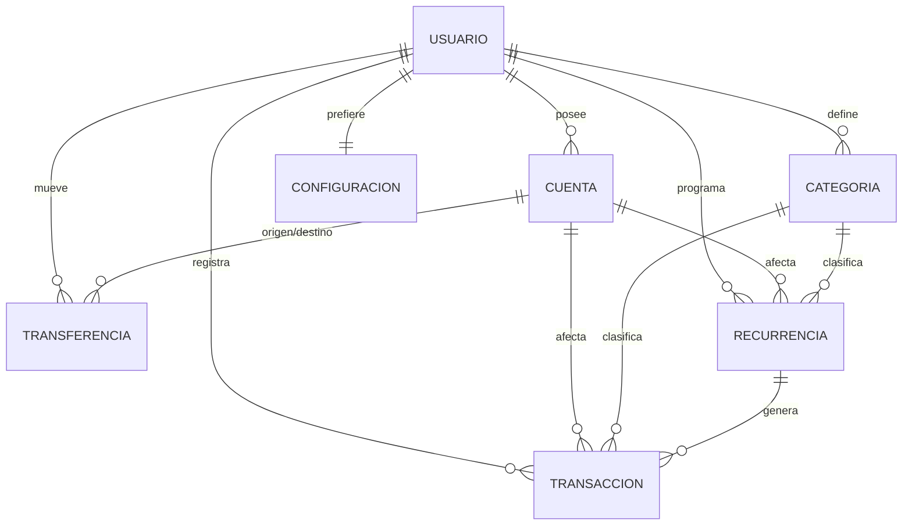

# 📊 FinTrack · Gestor de Finanzas Personales

Aplicación web **local-first** para registrar ingresos y gastos, controlar cuentas bancarias y efectivo, y consultar reportes. Funciona sin internet ni servidores: todos los datos viven en el navegador del usuario.

> **Este README es el documento técnico oficial del proyecto.**
> Todo cambio relevante (código, estructura, decisiones o pendientes) debe registrarse en la sección [Bitácora de cambios](#-bitácora-de-cambios).

---

## 📌 Estado del proyecto

| Área | Estado | Detalle |
| --- | --- | --- |
| Dominio (`src/models`) | ✅ Listo | Usuario, Cuenta, Categoría, Transacción, Transferencia y Recurrencia |
| Persistencia local | ✅ Listo | Dexie sobre IndexedDB (esquema v2) |
| Autenticación local | ✅ Listo | Registro abierto, login, código de recuperación |
| Aislamiento por usuario | ✅ Listo | Todas las entidades llevan `usuarioId` y se filtran por sesión |
| Contrato de datos v2 | ✅ Listo | `FinanzasService` + `LocalFinanzasService` |
| Movimientos recurrentes | ✅ Listo | Reglas diarias, semanales y mensuales; generación solo al llegar la fecha |
| Reportes | ✅ Listo | Estado de resultados, gastos por categoría, PDF y CSV |
| Interfaz de producto | 🚧 Fuera de esta entrega | La construirá el compañero de frontend |
| Demo funcional | ✅ Listo | `demo.html`: acceso, dashboard, movimientos, cuentas, categorías, reportes y perfil |
| Modo offline (PWA) | ✅ Listo | Manifiesto, service worker y precache; instalable y 100 % offline |
| Sincronización remota | ⏳ Futuro | Documentada como migración opcional |

### Alcance de esta entrega

1. Modelo de dominio completo con validaciones y serialización.
2. Persistencia real en IndexedDB mediante Dexie.
3. Servicio único de datos con sesión, aislamiento por usuario y reportes.
4. Seguridad local: hash PBKDF2, sal por credencial y código de recuperación rotativo.
5. Exportación de respaldos JSON, CSV y reportes PDF.
6. Movimientos recurrentes diarios, semanales y mensuales sin proyecciones futuras.
7. Demo funcional con React + Bootstrap, **sin CSS propio**.
8. PWA instalable con manifiesto, service worker y precache de todos los assets.

**Regla de la entrega:** toda la interfaz visual vive solo en `src/dev` y `demo.html`. **No se modificaron** `src/App.tsx`, `src/main.tsx`, `src/App.css` ni `src/index.css`; el compañero de frontend los trabajará después. La demo se apoya únicamente en React Bootstrap.

---

## 🧰 Tecnologías

| Capa | Tecnología |
| --- | --- |
| Frontend | React 19 + TypeScript 6 |
| Empaquetador | Vite 8 |
| UI | Bootstrap 5 + React Bootstrap (sin CSS propio) |
| Persistencia | Dexie 4 + IndexedDB |
| Gráficos | Chart.js 4 + react-chartjs-2 |
| Reportes | jsPDF + jspdf-autotable |
| PWA | `vite-plugin-pwa` 2 + Workbox 7 |
| Pruebas de humo | Node + `fake-indexeddb` + `vite.ssrLoadModule` |
| Calidad | ESLint 10 + `tsc` |

---

## 🚀 Puesta en marcha

Requisitos: Node.js 20 o superior y npm.

```bash
npm install
npm run dev
```

| Comando | Descripción |
| --- | --- |
| `npm run dev` | Servidor de desarrollo en `http://localhost:5173` |
| `npm run build` | Verificación de tipos + build de producción |
| `npm run lint` | Análisis estático con ESLint |
| `npm test` | Pruebas de humo del servicio con `fake-indexeddb` |
| `npm run preview` | Sirve el build de producción (necesario para probar la PWA) |
| `node scripts/generar-iconos.mjs` | Regenera `public/pwa-192x192.png` y `public/pwa-512x512.png` |

**Demo funcional:** `http://localhost:5173/demo.html`

La demo no forma parte del build de producción: `vite build` solo incluye `index.html`. Sirve como referencia visual y funcional para el frontend.

---

## 📁 Estructura del proyecto

```
app-contabilidad/
├── demo.html                       # Entrada de la demo (solo desarrollo)
├── index.html                      # Entrada de la aplicación real
├── vite.config.ts                  # React + VitePWA (manifiesto y service worker)
├── public/
│   ├── favicon.svg                 # Icono del navegador
│   ├── icons.svg                   # Iconos auxiliares
│   ├── pwa-192x192.png             # Icono PWA 192 x 192
│   └── pwa-512x512.png             # Icono PWA 512 x 512
├── scripts/
│   ├── generar-iconos.mjs          # Regenera los PNG de la PWA sin dependencias
│   └── smoke.mjs                   # Pruebas de humo del servicio (Node)
├── src/
│   ├── config/
│   │   └── app.ts                  # Moneda, locale, versión de BD, sesión, hash
│   ├── db/
│   │   ├── baseDatos.ts            # Esquema Dexie v2 (incluye recurrencias)
│   │   └── semilla.ts              # 34 categorías base, cuenta y configuración
│   ├── dev/                        # Demo: TODO lo visual
│   │   ├── componentes/
│   │   │   ├── Estado.tsx          # Cargando, AlertaErrorCarga, TarjetaKpi
│   │   │   ├── ErrorBoundary.tsx   # Límite de errores de render
│   │   │   ├── Graficos.tsx        # Gráfico de flujo y de categorías
│   │   │   ├── Notificaciones.tsx  # Provider y toasts de React Bootstrap
│   │   │   ├── notificacionesContexto.ts # Contexto y useNotificaciones()
│   │   │   ├── TablaRecurrencias.tsx # Reglas recurrentes: pausar y eliminar
│   │   │   └── useErroresFormulario.ts   # Errores inline por campo
│   │   ├── pantallas/
│   │   │   ├── Acceso.tsx          # Login, registro, recuperación, código
│   │   │   ├── Dashboard.tsx       # KPIs, gráficos, últimos movimientos
│   │   │   ├── Movimientos.tsx     # Alta (con repetición), filtros y eliminación
│   │   │   ├── Cuentas.tsx         # Saldos, cuentas y transferencias
│   │   │   ├── Categorias.tsx      # Árbol ingreso/gasto y alta
│   │   │   ├── Reportes.tsx        # Periodo, estado de resultados, PDF y CSV
│   │   │   └── MiCuenta.tsx        # Perfil, contraseña, respaldo y borrado
│   │   ├── DemoDatos.tsx           # Shell: sesión, navbar y navegación
│   │   ├── main-demo.tsx           # Montaje de la demo
│   │   └── secciones.ts            # Secciones navegables
│   ├── models/
│   │   ├── Usuario.ts              # Usuario sin credenciales
│   │   ├── Cuenta.ts               # Efectivo, banco, ahorro, tarjeta
│   │   ├── Categoria.ts            # Categorías jerárquicas
│   │   ├── Transaccion.ts          # Ingreso o gasto
│   │   ├── Transferencia.ts        # Movimiento entre cuentas
│   │   ├── Recurrencia.ts          # Regla de gasto/ingreso repetitivo
│   │   ├── errores.ts              # ErrorValidacion
│   │   ├── tipos.ts                # Constantes, tipos y DTOs
│   │   └── index.ts                # Barrel del dominio
│   ├── services/
│   │   ├── FinanzasService.ts      # Contrato único (interfaz)
│   │   ├── LocalFinanzasService.ts # Implementación IndexedDB
│   │   └── index.ts                # Singleton `finanzasService`
│   ├── utils/
│   │   ├── criptografia.ts         # PBKDF2, sales y códigos
│   │   ├── descargas.ts            # Descargar y leer archivos
│   │   ├── errores.ts              # Normalizador de errores de la UI
│   │   ├── formato.ts              # Moneda CRC, fechas y etiquetas
│   │   ├── numeros.ts              # Redondeo y sumas
│   │   ├── recurrencia.ts          # Cálculo de ocurrencias y fin de mes
│   │   └── reportesPdf.ts          # Reportes con jsPDF + AutoTable
│   ├── App.tsx                     # Interfaz real (sin cambios)
│   └── main.tsx                    # Montaje real (sin cambios)
└── README.md
```

### Arquitectura local-first

```
Demo (React + Bootstrap)
        │  solo conoce la interfaz
        â–¼
finanzasService  ◄── contrato único (src/services/index.ts)
        │
        â–¼
LocalFinanzasService
        │  obtiene el usuario de la sesión
        â–¼
Dexie  ──►  IndexedDB (fintrack)
```

Regla de oro: **la interfaz nunca importa `LocalFinanzasService`**. Siempre usa `finanzasService`.

No hay llamadas de red en ningún punto de la aplicación: el flujo completo funciona con el servidor de desarrollo apagado una vez cargada la página.

---

## 🔐 Seguridad y aislamiento

| Aspecto | Implementación |
| --- | --- |
| Contraseñas | PBKDF2-SHA256, 210 000 iteraciones, sal aleatoria de 16 bytes por usuario |
| Comparación | Tiempo constante para evitar filtraciones por temporización |
| Código de recuperación | 12 caracteres (`XXXX-XXXX-XXXX`), alfabeto sin caracteres ambiguos |
| Almacenamiento del código | Hash PBKDF2 con **sal independiente**; nunca en claro |
| Rotación | El código se muestra una sola vez y se reemplaza al usarlo |
| Sesión | Solo el `usuarioId` en `sessionStorage` (`fintrack:sesion:v1`) |
| Validación de sesión | Cada operación verifica que el usuario exista en la base |
| Intentos fallidos | Espera exponencial tras 3 intentos (1 s, 2 s, 4 s… máximo 8 s) |
| Roles | No existen: registro abierto, sin administrador |
| Aislamiento | Todas las consultas filtran por `usuarioId`; las entidades ajenas se rechazan |

El servicio nunca devuelve hashes ni sales: el dominio expone `Usuario` sin credenciales. Las credenciales viven únicamente en la tabla interna `usuarios`.

> **Límite honesto:** al ser una aplicación local, la protección depende del navegador y del equipo. Los datos de IndexedDB no están cifrados en reposo; el hash protege las contraseñas, no el contenido financiero.

---

## 🧩 Modelo de datos



### `Usuario`

| Campo | Tipo | Descripción |
| --- | --- | --- |
| `id` | `string` | Identificador único (`usr-...`) |
| `nombre` | `string` | Nombre completo |
| `correo` | `string` | Correo normalizado a minúsculas; único |
| `creadoEn` | `string` | Fecha de creación ISO 8601 |
| `ultimoAcceso` | `string` | Último inicio de sesión ISO 8601 |

Miembro calculado: `iniciales` (`"Ana Rodríguez"` → `"AR"`).

### `Cuenta`

| Campo | Tipo | Descripción |
| --- | --- | --- |
| `id` | `string` | Identificador único (`cta-...`) |
| `usuarioId` | `string` | Dueño de la cuenta |
| `nombre` | `string` | Único por usuario (sin distinguir mayúsculas ni tildes) |
| `tipo` | `"efectivo"` \| `"banco"` \| `"ahorro"` \| `"tarjeta"` | Tipo fijo |
| `saldoInicial` | `number` | Punto de partida |
| `moneda` | `string` | `CRC` por defecto |
| `institucion` | `string` | Banco o entidad, opcional |
| `color` / `icono` | `string` | Presentación |
| `activa` | `boolean` | Las archivadas no admiten movimientos nuevos |
| `creadoEn` | `string` | ISO 8601 |

El **saldo no se almacena**: se calcula con saldo inicial + ingresos − gastos confirmados ± transferencias.

### `Categoria`

| Campo | Tipo | Descripción |
| --- | --- | --- |
| `id` | `string` | Identificador único (`cat-...`) |
| `usuarioId` | `string` | Dueño |
| `nombre` | `string` | Único entre hermanas del mismo tipo |
| `tipo` | `"ingreso"` \| `"gasto"` | Fijo desde su creación |
| `padreId` | `string \| null` | Categoría padre para jerarquía |
| `color` / `icono` | `string` | Presentación |

### `Transaccion`

| Campo | Tipo | Descripción |
| --- | --- | --- |
| `id` | `string` | Identificador único (`trx-...`) |
| `usuarioId` | `string` | Dueño |
| `cuentaId` | `string` | Cuenta afectada |
| `monto` | `number` | Siempre positivo, 2 decimales |
| `tipo` | `"ingreso"` \| `"gasto"` | Naturaleza del movimiento |
| `fecha` | `string` | Fecha real `AAAA-MM-DD` |
| `descripcion` | `string` | Obligatoria |
| `categoriaId` | `string` | Categoría del mismo tipo |
| `metodoPago` | `efectivo` \| `tarjeta` \| `transferencia` \| `sinpe` \| `otro` | Por defecto `otro` |
| `estado` | `"confirmado"` \| `"pendiente"` | Solo los confirmados afectan saldos y reportes |
| `etiquetas` | `string[]` | Sin duplicados |
| `creadoEn` | `string` | ISO 8601 |
| `recurrenciaId` | `string?` | Regla que generó el movimiento, si aplica |
| `recurrenciaFecha` | `string?` | Fecha de la ocurrencia dentro de la serie |

Miembros calculados: `esIngreso`, `montoFirmado`, `periodo` (`AAAA-MM`).

### `Transferencia`

| Campo | Tipo |
| --- | --- |
| `id` | `string` (`trf-...`) |
| `usuarioId` | `string` |
| `cuentaOrigenId` / `cuentaDestinoId` | `string` (deben ser distintas) |
| `monto` | `number` (> 0) |
| `fecha` | `AAAA-MM-DD` |
| `descripcion` | `string` (opcional) |
| `creadoEn` | ISO 8601 |

Las transferencias se guardan **aparte** de las transacciones: mueven saldos, pero no son ingreso ni gasto en los reportes.

### `Recurrencia`

| Campo | Tipo | Descripción |
| --- | --- | --- |
| `id` | `string` | Identificador único (`rec-...`) |
| `usuarioId` | `string` | Dueño de la regla |
| `cuentaId` / `categoriaId` | `string` | Referencias validadas contra el usuario y el tipo |
| `monto` | `number` | Siempre positivo, 2 decimales |
| `tipo` | `"ingreso"` \| `"gasto"` | Naturaleza del movimiento |
| `descripcion` | `string` | Obligatoria |
| `metodoPago` | `MetodoPago` | Se copia en cada ocurrencia |
| `etiquetas` | `string[]` | Se copian en cada ocurrencia |
| `frecuencia` | `"diaria"` \| `"semanal"` \| `"mensual"` | Cadencia de la serie |
| `fechaInicio` | `string` | Primera fecha de la serie (`AAAA-MM-DD`) |
| `fechaFin` | `string \| null` | Fin opcional de la serie |
| `diaAncla` | `number` | Día original del mes (1–31) para frecuencias mensuales |
| `proximaFecha` | `string` | Siguiente ocurrencia pendiente de generar |
| `activa` | `boolean` | Pausada o activa |
| `creadoEn` | `string` | ISO 8601 |

La regla **no crea movimientos virtuales ni proyecciones**: cuando `proximaFecha <= hoy`, el servicio inserta una transacción real, avanza `proximaFecha` y repite hasta agotar las ocurrencias vencidas. Las fechas futuras nunca se registran, por lo que los saldos no se alteran por adelantado.

### `ConfiguracionUsuario`

`usuarioId`, `moneda` (`CRC`), `locale` (`es-CR`) y `tema` (`claro`).

### Enumeraciones (sin `enum`)

El proyecto compila con `erasableSyntaxOnly`, por lo que no se usan `enum`. Se emplean objetos `as const` que funcionan como valor y como tipo:

```ts
import { TipoCuenta, TipoTransaccion, TIPOS_CUENTA } from '../models';

TipoTransaccion.Ingreso; // 'ingreso'
TipoCuenta.Banco;        // 'banco'
```

---

## ✅ Reglas de negocio

1. El monto debe ser un número finito **mayor que cero**; el signo lo define el tipo.
2. Los montos se redondean a **2 decimales** al guardarse.
3. La fecha debe existir en el calendario y usar `AAAA-MM-DD`.
4. La descripción de una transacción es obligatoria.
5. Toda transacción apunta a una cuenta activa y a una categoría **del mismo usuario**.
6. El tipo de la categoría debe coincidir con el tipo de la transacción.
7. El nombre de una cuenta es único por usuario; el de una categoría, único entre hermanas del mismo tipo (sin mayúsculas ni tildes).
8. El tipo de una categoría no se puede cambiar; una subcategoría hereda el tipo de su padre.
9. Una cuenta archivada conserva historial pero no admite movimientos nuevos.
10. Los saldos y reportes solo consideran transacciones **confirmadas**.
11. Las transferencias requieren cuentas distintas y no alteran ingresos ni gastos.
12. Al registrarse se crean 34 categorías base, una cuenta de efectivo con saldo 0 y la configuración CRC/es-CR.
13. Los errores de negocio se lanzan como `ErrorValidacion` con un `campo` opcional.
14. El servicio devuelve copias: mutarlas no altera la base.
15. Una regla recurrente genera transacciones **solo cuando su fecha ya llegó** (`fecha <= hoy`); nunca se registran movimientos futuros ni proyecciones.
16. Al crear una regla se recuperan todas las ocurrencias vencidas desde `fechaInicio`; si la fecha es futura, no se crea ningún movimiento todavía.
17. `proximaFecha` y las inserciones se actualizan en la misma transacción Dexie, de modo que procesar dos veces es idempotente.
18. Las ocurrencias se guardan **confirmadas** y quedan vinculadas con `recurrenciaId` y `recurrenciaFecha`.
19. En frecuencias mensuales se usa `diaAncla` recortado al último día del mes: 31 de enero → 28/29 de febrero → 31 de marzo, sin desplazamiento permanente.
20. Al archivar una cuenta se pausan sus reglas; al eliminarlas o pausarlas, las transacciones ya generadas se conservan como historial.

---

## 🔌 Contrato del servicio (`FinanzasService`)

```ts
import { finanzasService } from './services';
```

La interfaz **no recibe `usuarioId`**: el servicio lo toma de la sesión activa.

### Sesión y cuenta

| Método | Devuelve | Notas |
| --- | --- | --- |
| `registrar(datos)` | `ResultadoRegistro` | Devuelve el código de recuperación una sola vez e inicia sesión |
| `iniciarSesion(correo, contrasena)` | `Usuario` | Normaliza el correo; aplica espera tras fallos |
| `cerrarSesion()` | `void` | Limpia `sessionStorage` |
| `usuarioActual()` | `Usuario \| null` | Valida la sesión contra la base |
| `cambiarContrasena(actual, nueva)` | `void` | Exige la contraseña actual |
| `recuperarContrasena(correo, codigo, nueva)` | `ResultadoRecuperacion` | Rota el código de recuperación |
| `eliminarCuenta(contrasena)` | `void` | Borra usuario y todos sus datos |
| `obtenerConfiguracion()` | `ConfiguracionUsuario` | Crea la configuración si falta |

### Cuentas

| Método | Devuelve | Notas |
| --- | --- | --- |
| `listarCuentas()` | `Cuenta[]` | Orden alfabético |
| `crearCuenta(datos)` | `Cuenta` | Valida nombre único |
| `actualizarCuenta(id, cambios)` | `Cuenta` | Permite archivar/reactivar |
| `transferir(datos)` | `Transferencia` | Valida pertenencia y cuentas distintas |
| `obtenerSaldos()` | `SaldoCuenta[]` | Calculados con movimientos confirmados |

### Categorías

| Método | Devuelve | Notas |
| --- | --- | --- |
| `listarCategorias(tipo?)` | `Categoria[]` | Filtro opcional por tipo |
| `crearCategoria(datos)` | `Categoria` | Valida padre, tipo y nombre único entre hermanas |

### Transacciones

| Método | Devuelve | Notas |
| --- | --- | --- |
| `listarTransacciones(filtro?)` | `Transaccion[]` | Orden por defecto: fecha descendente |
| `obtenerTransaccion(id)` | `Transaccion \| null` | `null` si es de otro usuario |
| `crearTransaccion(datos)` | `Transaccion` | Valida cuenta, categoría y tipo |
| `actualizarTransaccion(id, cambios)` | `Transaccion` | Cambios parciales validados |
| `eliminarTransaccion(id)` | `void` | Falla si no existe o es ajena |

### Recurrencias

| Método | Devuelve | Notas |
| --- | --- | --- |
| `listarRecurrencias()` | `Recurrencia[]` | Activas primero, luego por próxima fecha |
| `crearRecurrencia(datos)` | `ResultadoCreacionRecurrencia` | Crea la regla y genera las ocurrencias vencidas |
| `actualizarRecurrencia(id, cambios)` | `Recurrencia` | Permite pausar/reanudar y fijar `fechaFin` |
| `eliminarRecurrencia(id)` | `void` | Conserva las transacciones ya generadas |
| `procesarRecurrencias()` | `number` | Genera lo vencido de todas las reglas activas; devuelve cuántas creó |

`NuevaRecurrencia` acepta `monto`, `tipo`, `fechaInicio`, `descripcion`, `categoriaId`, `cuentaId`, `frecuencia`, `fechaFin?`, `metodoPago?` y `etiquetas?`. El servicio valida las referencias con la misma lógica que una transacción.

```ts
const { recurrencia, generadas } = await finanzasService.crearRecurrencia({
  monto: 42000,
  tipo: 'gasto',
  fechaInicio: '2026-11-15',
  descripcion: 'Luz',
  categoriaId: 'cat-...',
  cuentaId: 'cta-...',
  frecuencia: 'mensual',
  fechaFin: null,
});

// Si hoy es 2026-11-15 y la regla empieza hoy, generadas === 1.
// Si empieza el 2026-12-01, generadas === 0 y proximaFecha === '2026-12-01'.
```

### Reportes y datos

| Método | Devuelve | Notas |
| --- | --- | --- |
| `obtenerResumen(filtro?)` | `ResumenFinanciero` | Totales, categorías, meses y rango |
| `obtenerEstadoResultados(desde, hasta)` | `EstadoResultados` | Filas por categoría |
| `obtenerFlujoCaja(desde, hasta)` | `ResumenMensual[]` | Ingresos, gastos y balance por mes |
| `exportarRespaldo()` | `RespaldoFinanzas` | JSON completo del usuario |
| `importarRespaldo(respaldo)` | `void` | Reemplaza datos; **regenera ids y remapea referencias** |
| `exportarTransaccionesCsv(filtro?)` | `string` | Cabecera en español, separador coma |
| `resetearDatos()` | `void` | Borra movimientos y reglas, y restaura categorías base |

### Filtros disponibles

```ts
interface FiltroTransacciones {
  desde?: string;              // AAAA-MM-DD, inclusive
  hasta?: string;              // AAAA-MM-DD, inclusive
  tipo?: TipoTransaccion;
  categoriaId?: string;
  cuentaId?: string;
  metodoPago?: MetodoPago;
  estado?: EstadoTransaccion;
  texto?: string;              // descripción, categoría, cuenta y etiquetas
  orden?: 'fecha-desc' | 'fecha-asc' | 'monto-desc' | 'monto-asc';
}
```

`ResumenFinanciero` expone `totalIngresos`, `totalGastos`, `balance`, cantidades, promedios, `porCategoria` (con porcentaje por tipo), `porMes` y el rango real cubierto. `porCategoria` se ordena de mayor a menor monto; `porMes`, del mes más antiguo al más reciente.

---

## 🗄️ Persistencia (IndexedDB con Dexie)

Base: **`fintrack`**, versión de esquema **2** (`src/db/baseDatos.ts`). Al cambiar tablas o índices hay que incrementar `versionBaseDatos` en `src/config/app.ts`. La migración v1 → v2 agrega la tabla de reglas y el índice `recurrenciaId` sin perder datos existentes.

| Tabla | Clave primaria | Índices |
| --- | --- | --- |
| `usuarios` | `id` | `&correo` (único) |
| `cuentas` | `id` | `usuarioId`, `[usuarioId+tipo]` |
| `categorias` | `id` | `usuarioId`, `padreId`, `[usuarioId+tipo]` |
| `transacciones` | `id` | `usuarioId`, `cuentaId`, `categoriaId`, `fecha`, `recurrenciaId`, `[usuarioId+fecha]`, `[usuarioId+cuentaId]`, `[usuarioId+categoriaId]`, `[usuarioId+recurrenciaId]` |
| `transferencias` | `id` | `usuarioId`, `cuentaOrigenId`, `cuentaDestinoId`, `[usuarioId+fecha]` |
| `recurrencias` | `id` | `usuarioId`, `[usuarioId+activa]` |
| `configuracion` | `usuarioId` | — |

La tabla `usuarios` guarda además `hashContrasena`, `sal`, `hashRecuperacion` y `salRecuperacion`; esos campos nunca salen del servicio.

### Semilla por usuario

- **34 categorías** jerárquicas pensadas para Costa Rica: salario, outsourcing (SINPE/efectivo), inversiones, servicios del hogar, suscripciones, alimentación (supermercado, minisúper, cafetería, restaurante, express), transporte (Didi/Uber, gasolina, bus/tren, mantenimiento), salud, educación, ocio, compras, mascotas y otros.
- Cuenta **Efectivo** con saldo 0.
- Configuración **CRC / es-CR / tema claro**.

### Respaldos

- Se exportan como JSON con `version`, `exportadoEn`, usuario y todas las colecciones, incluidas las reglas recurrentes.
- La versión actual es **2**. La importación acepta respaldos **v1** (sin reglas) y **v2**; se rechazan versiones futuras o archivos incompletos.
- Al importar se valida la versión y la integridad de las referencias, incluidas las de las reglas.
- Los ids se **regeneran** y las relaciones se remapean (también `recurrenciaId` en cada movimiento) para evitar colisiones cuando varios usuarios comparten la misma base local.

---

## 🖥️ Demo funcional (`/demo.html`)

| Pantalla | Contenido |
| --- | --- |
| **Acceso** | Login, registro abierto, recuperación con código y pantalla de código único |
| **Dashboard** | KPIs del mes, patrimonio, flujo mensual, gastos por categoría y últimos movimientos |
| **Movimientos** | Alta con tipo/monto/fecha/categoría/cuenta/método/estado/etiquetas y casilla **Repetir** (diaria, semanal o mensual, con fin opcional); administración de reglas (pausar, reanudar, eliminar), filtros y eliminación; botón de 8 ejemplos |
| **Cuentas** | Saldos calculados, alta y archivado de cuentas, transferencias entre cuentas |
| **Categorías** | Árbol ingreso/gasto con uso real y alta de raíces o subcategorías |
| **Reportes** | Rango de fechas con atajos, estado de resultados, gráficos, PDF y CSV |
| **Mi cuenta** | Perfil, cambio de contraseña, respaldo exportar/importar, reset y eliminación |

La navegación es por estado (no hay router instalado). Toda la UI usa React Bootstrap: no hay archivos CSS nuevos. Los resultados de las acciones se informan con toasts; los errores de campo se muestran inline y los fallos de carga con una alerta que permite reintentar.

### Cómo funcionan los movimientos recurrentes

- En el formulario de movimientos, la casilla **“Repetir este movimiento”** convierte el alta en una regla. Se elige frecuencia (cada día, cada semana o cada mes) y, opcionalmente, una fecha final.
- Si la fecha de inicio es **hoy o anterior**, se registran de inmediato las ocurrencias vencidas (cada una con su fecha real). Si es **futura**, no se crea nada todavía: la tarjeta de reglas muestra la próxima fecha.
- Al abrir la demo, la app procesa las reglas activas antes de mostrar el dashboard. Si estuvo cerrada varios días, recupera las ocurrencias atrasadas sin duplicarlas.
- Las transacciones generadas se marcan con 🔁 y se guardan confirmadas.
- **Pausar** detiene la generación; **Reanudar** recupera lo vencido durante la pausa. **Eliminar** borra la regla pero conserva los movimientos ya generados.
- En mensuales, el día se recorta al último del mes sin perder el original: una regla del día 31 genera el 28 de febrero de 2026 y vuelve al 31 en marzo.
- Si se archiva la cuenta asociada, sus reglas se pausan automáticamente.

### Reportes PDF

- **Estado de resultados:** ingresos, gastos y utilidad del periodo.
- **Gastos por categoría:** total, movimientos y porcentaje del gasto.
- Se generan con texto y tablas nativas de jsPDF (no capturas), con encabezado, pie y numeración.
- Los montos se escriben como `CRC 1 234,56` porque la fuente estándar de jsPDF no incluye el símbolo `₡`.

---

## 📲 PWA e instalación offline

La aplicación se puede instalar en escritorio o móvil y funciona sin conexión después de la primera visita.

### Configuración

`vite.config.ts` integra `VitePWA` con:

- `registerType: 'autoUpdate'`: la versión nueva del service worker se activa sola y `cleanupOutdatedCaches` elimina las cachés anteriores.
- `injectRegister: 'auto'`: el registro del service worker se inyecta en el HTML generado, **sin tocar `src/main.tsx`**.
- `workbox.globPatterns: ['**/*.{js,css,html,ico,png,svg,woff2}']`: precachea todo el shell estático.
- `navigateFallback: '/index.html'`: cualquier ruta del SPA se resuelve desde la caché.

El manifiesto declara `name`, `short_name`, `description`, `start_url: "/"`, `display: "standalone"`, `background_color: "#ffffff"`, `theme_color: "#0d6efd"`, `lang: "es-CR"` e iconos de 192 y 512 px.

| Artefacto del build | Contenido |
| --- | --- |
| `dist/manifest.webmanifest` | Manifiesto de la aplicación |
| `dist/sw.js` | Service worker con el precache de los assets |
| `dist/registerSW.js` | Registro inyectado en `index.html` |
| `dist/workbox-*.js` | Runtime de Workbox |

Los iconos son PNG generados localmente por `scripts/generar-iconos.mjs`, un script sin dependencias que dibuja el cuadrado azul con barras blancas y escribe el PNG con `node:zlib`. Se pueden sustituir por un diseño propio manteniendo los nombres y tamaños.

### Instalación y prueba offline

1. `npm run build` y `npm run preview`.
2. Abrir `http://localhost:4173`.
3. Instalar desde el icono de la barra de direcciones (escritorio) o desde el menú del navegador → “Instalar aplicación” / “Añadir a pantalla de inicio” (móvil).
4. En DevTools → Application → Service Workers, activar **Offline** y recargar: la app abre y opera con IndexedDB.

> El service worker solo se registra en `localhost` o HTTPS. La primera visita necesita red para descargar la app; a partir de ahí todo queda cacheado. `demo.html`, `src/dev` y el código de desarrollo no entran al build ni al precache.

---

## 👩‍💻 Guía rápida para el frontend

### 1. Arrancar la demo y entrar

```bash
npm run dev
# abrir http://localhost:5173/demo.html
```

Registre un usuario; el código de recuperación se muestra una sola vez.

### 2. Leer datos

```tsx
import { useEffect, useState } from 'react';
import type { ResumenFinanciero } from './models';
import { finanzasService } from './services';

function Panel() {
  const [resumen, setResumen] = useState<ResumenFinanciero | null>(null);

  useEffect(() => {
    let activo = true;
    finanzasService.obtenerResumen().then((datos) => {
      if (activo) setResumen(datos);
    });
    return () => {
      activo = false;
    };
  }, []);

  if (!resumen) return <p>Cargando…</p>;
  return <p>Balance: {resumen.balance}</p>;
}
```

### 3. Registrar un gasto

```tsx
import { MetodoPago, TipoTransaccion } from './models';
import { finanzasService } from './services';

await finanzasService.crearTransaccion({
  monto: 25000,
  tipo: TipoTransaccion.Gasto,
  fecha: '2026-11-15',
  descripcion: 'Supermercado',
  categoriaId: 'cat-...',
  cuentaId: 'cta-...',
  metodoPago: MetodoPago.Tarjeta,
});
```

### 4. Manejar errores

La demo aplica cuatro reglas de presentación:

| Situación | Presentación |
| --- | --- |
| Acción completada | Toast de éxito abajo a la derecha |
| Error de campo (`ErrorValidacion.campo`) | Mensaje inline bajo el campo (`isInvalid` + `Form.Control.Feedback`) |
| Error general o técnico | Toast de error con mensaje en español, sin detalles de Dexie/IndexedDB |
| Pantalla que no puede cargar | Alerta inline con botón **Reintentar** |

`normalizarError` convierte cualquier fallo en `{ mensaje, campo?, tipo }`. Los tipos son `validacion`, `sesion`, `almacenamiento` y `desconocido`.

```tsx
import { normalizarError } from './utils/errores';

try {
  await finanzasService.crearTransaccion(datos);
} catch (fallo) {
  const error = normalizarError(fallo);
  if (error.campo === 'monto') {
    setErrorMonto(error.mensaje); // inline
  } else {
    notificaciones.error(error.mensaje); // toast
  }
}
```

En el login no se marcan campos concretos: el toast usa el mismo mensaje para correo inexistente o contraseña incorrecta. Las acciones destructivas conservan `window.confirm`; el toast solo informa el resultado. `ErrorBoundary` evita que un fallo de render deje la sección en blanco.

### 5. Formatear valores

```ts
import { formatearMoneda, formatearFecha } from './utils/formato';

formatearMoneda(950000);        // "â‚¡950 000,00"
formatearFecha('2026-11-15');   // "15 de noviembre de 2026"
```

Las pantallas de `src/dev/pantallas` son la referencia completa de consumo del servicio.

---

## 🧭 Convenciones de código

- **Dominio en español** (`Transaccion`, `categoriaId`); infraestructura en inglés (`services`, `config`).
- **Sin `enum`**: objetos `as const` + tipo unión (requisito de `erasableSyntaxOnly`).
- **Sin parámetros de propiedad** en constructores (`constructor(private x)`), por la misma razón.
- `import type` obligatorio para importaciones de solo tipo (`verbatimModuleSyntax`).
- `noUnusedLocals` y `noUnusedParameters` activos.
- Fechas de dominio como `AAAA-MM-DD`; marcas de tiempo en ISO 8601.
- Montos positivos en el dominio; el signo se deriva con `montoFirmado`.
- Entidades con `toJSON()` y `desdeJSON()`.
- Operaciones de datos siempre asíncronas.
- Efectos de React que cargan datos usan promesas con guardas (`activo`) para cumplir `react-hooks/set-state-in-effect`.
- Gráficos: contenedor con `ratio ratio-16x9` y `maintainAspectRatio: false`.

### Reparto de archivos

| Zona | Responsable | Regla |
| --- | --- | --- |
| `src/models`, `src/services`, `src/db`, `src/utils`, `src/config` | Capa de datos | Cambios coordinados y registrados en la bitácora |
| `src/App.tsx`, `src/main.tsx`, `App.css`, `index.css` | Frontend | Reservado para el compañero; **no tocar desde la demo** |
| `src/dev`, `demo.html` | Demostración | Solo desarrollo; no se incluye en el build |

---

## 🧪 Verificación

```bash
npm run build   # tsc -b + vite build
npm run lint    # ESLint
npm test        # 75 comprobaciones de comportamiento
```

La prueba de humo (`scripts/smoke.mjs`) usa `fake-indexeddb` y `vite.ssrLoadModule` y cubre:

- registro, normalización de correo y correo duplicado;
- 34 categorías base, cuenta inicial y saldo 0;
- CRUD de cuentas y transacciones, validación de tipo y monto;
- saldos con gastos, ingresos y transferencias;
- reportes, estado de resultados, flujo mensual y CSV;
- aislamiento entre dos usuarios (lectura y escritura);
- respaldo, importación con ids regenerados y reseteo;
- movimientos recurrentes: ocurrencias vencidas, idempotencia, reglas futuras sin movimientos, pausa/reanudación, fin de mes, respaldo/importación con remapeo y aislamiento entre usuarios;
- normalización de errores de validación, sesión, cuota de almacenamiento y fallos técnicos;
- cambio de contraseña, recuperación con rotación de código y eliminación de cuenta.

El build de producción genera `dist/manifest.webmanifest`, `dist/sw.js` y los iconos de la PWA, y **no incluye** `demo.html` ni `src/dev`. Para verificarlo:

```powershell
npm run build
Select-String -Path dist/sw.js -Pattern 'demo\.html|src/dev'   # sin coincidencias
```

La instalación y el modo offline se comprueban con `npm run preview` y DevTools → Application → Manifest y Service Workers.

---

## 🗺️ Pendientes (roadmap)

- [ ] Interfaz de producto en `App.tsx` (a cargo del compañero de frontend).
- [x] Manifiesto PWA y service worker para instalación offline.
- [x] Presupuestos por categoría y alertas.
- [ ] Edición de movimientos desde la UI (el servicio ya la soporta).
- [ ] Edición de monto, categoría y frecuencia de reglas recurrentes desde la UI.
- [ ] Cifrado de la base local con frase de paso (opcional).
- [ ] Sincronización opcional con Supabase y RLS, si el cliente la pide más adelante.
- [ ] Exportación de reportes en otros formatos.

---

## 🗓️ Bitácora de cambios

| Fecha | Cambio | Archivos |
| --- | --- | --- |
| 2026-11-14 | Inicialización del repositorio con plantilla Vite + React + TypeScript y Bootstrap instalado. | `package.json`, `src/main.tsx` |
| 2026-11-14 | README inicial con la visión del gestor de finanzas personales. | `README.md` |
| 2026-11-14 | **Entrega 1 — capa de dominio y datos simulados.** Clases `Usuario`, `Categoria` y `Transaccion` con validaciones; tipos y DTOs; interfaz `FinanzasService`; `MockFinanzasService` con persistencia en `localStorage`, latencia simulada y copias defensivas; seed de 13 categorías y 39 transacciones relativas a la fecha actual; utilidades de formato para CRC y fechas; página demo `/demo.html`. | `src/models/*`, `src/services/*`, `src/data/seed.ts`, `src/utils/*`, `src/config/mock.ts`, `src/dev/*`, `demo.html` |
| 2026-11-14 | README convertido en documento técnico: arquitectura, modelo de datos, contrato del servicio, reglas de negocio, guía de consumo, persistencia, migración a Supabase, convenciones y bitácora. | `README.md` |
| 2026-11-14 | Variables de entorno documentadas y credenciales excluidas del repositorio. | `.env.example`, `.gitignore` |
| 2026-11-15 | **Entrega 2 — MVP local-first.** Se instalan Dexie, Chart.js, jsPDF, jspdf-autotable y fake-indexeddb. Se reemplazan el mock, el seed y la configuración simulada por una base IndexedDB real con sesión, aislamiento por usuario y credenciales PBKDF2. Se añaden cuentas, categorías jerárquicas, transferencias, respaldos y reportes. | `package.json`, `src/config/app.ts`, `src/db/*`, `src/models/*`, `src/services/*` |
| 2026-11-15 | Autenticación local: registro abierto sin roles, login, cambio de contraseña, recuperación con código de 12 caracteres mostrado una vez y rotado al usarlo, y eliminación de cuenta. | `src/utils/criptografia.ts`, `src/services/LocalFinanzasService.ts`, `src/models/Usuario.ts` |
| 2026-11-15 | Reportes y exportaciones: estado de resultados, gastos por categoría, PDF con jsPDF/AutoTable, CSV y respaldo JSON con remapeo de ids al importar. | `src/utils/reportesPdf.ts`, `src/utils/descargas.ts`, `src/services/LocalFinanzasService.ts` |
| 2026-11-15 | Demo visual completa solo en `src/dev`: acceso, dashboard, movimientos, cuentas, categorías, reportes y mi cuenta, con navegación por estado y React Bootstrap. No se tocaron `App.tsx`, `main.tsx` ni los CSS. | `src/dev/*`, `demo.html` |
| 2026-11-15 | Prueba de humo automatizada (`npm test`) con 44 verificaciones sobre `fake-indexeddb`; se corrige la importación de respaldos para regenerar identificadores y remapear referencias. | `scripts/smoke.mjs`, `package.json`, `src/services/LocalFinanzasService.ts` |
| 2026-11-15 | README reescrito como documento técnico del MVP local-first: arquitectura, seguridad, modelo, contrato v2, persistencia, demo y verificación. | `README.md` |
| 2026-11-15 | **Nivel B — manejo de errores en la demo.** Normalizador compartido (`normalizarError`), toasts de React Bootstrap, validación inline por campo, alertas con reintento para cargas fallidas y `ErrorBoundary`. El login usa un mensaje genérico para no revelar si el correo existe; las acciones destructivas conservan la confirmación. La prueba de humo sube de 44 a 48 comprobaciones. | `src/utils/errores.ts`, `src/dev/componentes/Notificaciones.tsx`, `notificacionesContexto.ts`, `useErroresFormulario.ts`, `ErrorBoundary.tsx`, `Estado.tsx`, `src/dev/pantallas/*`, `src/dev/DemoDatos.tsx`, `scripts/smoke.mjs`, `README.md` |
| 2026-11-15 | **Movimientos recurrentes.** Nueva entidad `Recurrencia` con frecuencias diaria, semanal y mensual; tabla Dexie v2, índice `recurrenciaId` y migración sin pérdida de datos. El servicio crea reglas, genera ocurrencias vencidas hasta hoy (nunca futuras), recupera atrasos al iniciar sesión, evita duplicados con avance atómico de `proximaFecha` y conserva el historial al pausar o eliminar. Fin de mes anclado al día original. Respaldos v2 con retrocompatibilidad v1. UI en Movimientos: casilla “Repetir”, fecha final opcional y tarjeta de reglas con pausar/reanudar/eliminar. La prueba de humo sube de 48 a 75 comprobaciones. | `src/models/Recurrencia.ts`, `tipos.ts`, `Transaccion.ts`, `index.ts`, `src/utils/recurrencia.ts`, `formato.ts`, `src/db/baseDatos.ts`, `src/config/app.ts`, `src/services/*`, `src/dev/pantallas/Movimientos.tsx`, `src/dev/componentes/TablaRecurrencias.tsx`, `src/dev/DemoDatos.tsx`, `scripts/smoke.mjs`, `README.md` |
| 2026-11-16 | **PWA offline e instalable.** Se instala `vite-plugin-pwa` 2 y se configura `VitePWA` con `registerType: 'autoUpdate'`, precache de JS/CSS/HTML/ICO/PNG/SVG/WOFF2, `cleanupOutdatedCaches` y `navigateFallback` al `index.html`. Manifiesto FinTrack en modo `standalone` con `theme_color: #0d6efd` e iconos de 192 y 512 px. El registro del service worker se inyecta automáticamente, sin tocar `main.tsx`. Se añaden los iconos PNG generados por `scripts/generar-iconos.mjs` (sin dependencias) y en `index.html` el `theme-color` y el `apple-touch-icon`. El build produce `manifest.webmanifest` y `sw.js` sin incluir `demo.html` ni `src/dev`; build, lint y 75 pruebas en verde. | `package.json`, `package-lock.json`, `vite.config.ts`, `index.html`, `public/pwa-192x192.png`, `public/pwa-512x512.png`, `scripts/generar-iconos.mjs`, `README.md` |
| 2026-11-16 | **Sistema híbrido de control de gastos y presupuestos.** Entidad Presupuesto con validaciones y serialización. Esquema Dexie v3 con tabla presupuestos e índices compuestos. CRUD de presupuestos con cálculo de consumo acumulado por jerarquía (subcategorías) y clasificación de estados (
ormal, dvertencia, excedido). Alerta automática por concentración de gasto (>= 30% del gasto total). Meta de ahorro mensual en configuración y progreso en tiempo real. Soporte completo en respaldos v3 con retrocompatibilidad v1/v2. En UI: Alertas de consumo y progreso en Dashboard, gestión de presupuestos en Categorías y meta de ahorro en Mi Cuenta. Pruebas de humo suben a 91 verificaciones. | src/models/*, src/db/*, src/services/*, src/dev/*, scripts/smoke.mjs, README.md |
